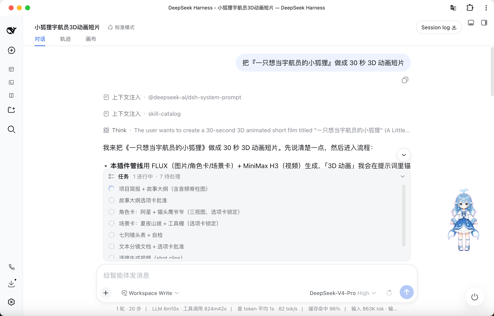
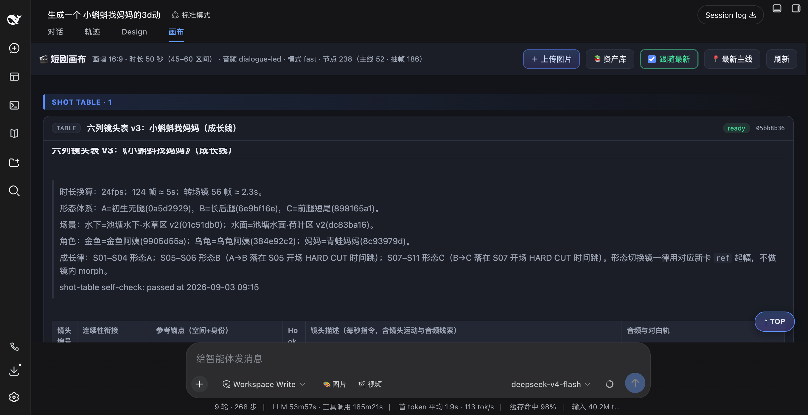
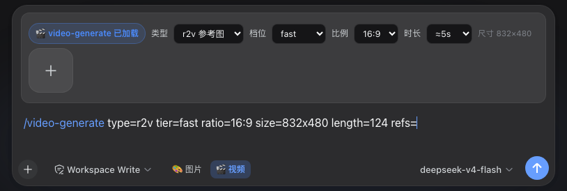
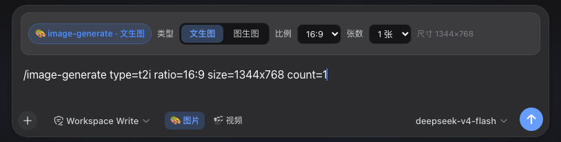
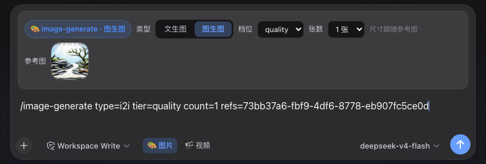
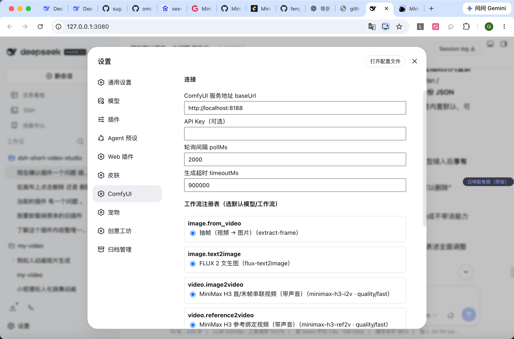
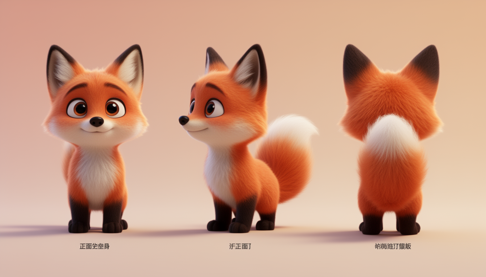
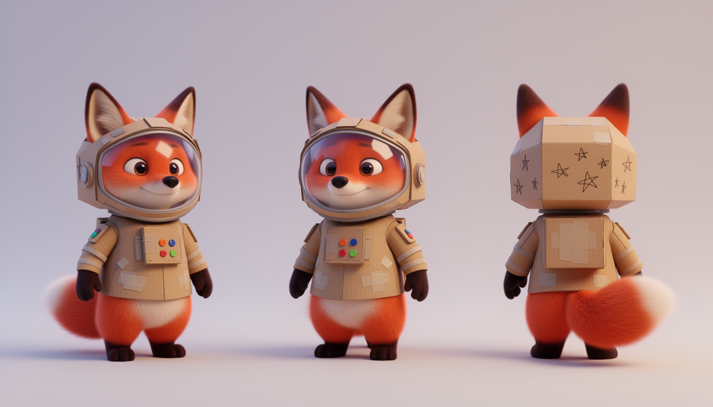
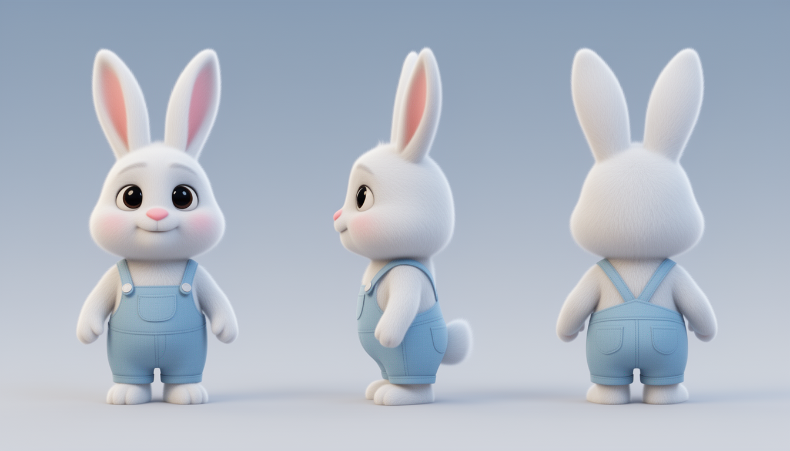

# dsh-short-video-studio
[](https://dsh-plugin.org/plugins/fengyungithub/dsh-short-video-studio)

**完全本地 · 免费 · 零云端依赖**的**短剧 / 动画画布工作室**，作为 [DeepSeek Harness](https://github.com/deepseek-ai) 双面插件运行。所有生成都跑在**本地 ComfyUI** 上——不需要任何付费云 API、不消耗额度，装好即用，一次生成、无限出片。

**画质已可达 2K / 4K 交付**：生成侧有**两阶段潜空间放大**（hires：首遍 896×512 → latent ×1.5 → 二遍重建，交付 1344×768）与**学习式 3D latent 放大**（`…-2k` 族：×2 → 交付 **2688×1536**）；后处理侧有独立的**视频超分** `video.upscale`（逐帧 CNN ×2/×4 + **RelayVSR** 参考帧扩散 ×2/×4，×2 仅 **25.3s**，**内容不变、音轨原样带回**）与**视频重生成** `video.regenerate`（Open-H3 Regenerate，1080p/2K，**会重画内容**）。加速侧可选 **Pika H3 Flex 6 步 / PDD 8 步 / Sol-Attn 块稀疏**，见[社区加速与放大技术](#社区加速与放大技术2026-11-重点)。

> 一句话：**Agent 按你定义的 skill 编排流程，把生成请求派发到本地 ComfyUI 执行，产物落进可视化画布，还能通过飞书远程操控创作。**

> **🌟 模型无关**：FLUX 2 / MiniMax H3 只是插件随附的**内置默认工作流**，不是产品边界。本插件是通用的 ComfyUI 工作流执行器 + 能力注册表——**任何 ComfyUI 能跑的模型**（SDXL / SD3.5 / Qwen-Image / Wan / CogVideoX / LTX / 本地 Kling 等，图片或视频、带不带声音都可以）都能通过[导入一份工作流清单](#扩展导入你自己的-comfyui-workflow)接入，skill 与工具契约无需任何改动。换模型 = 加一份 JSON。

## 30 秒速览

- **是什么**：本地 ComfyUI 上的短剧 / 动画画布工作室——Agent 按 skill 编排，产物落画布，可飞书远程创作。
- **零云端成本**：默认图片 FLUX 2、视频 MiniMax H3（带声音、原生字幕），全部本地跑；模型可整体替换。
- **画质**：原生 768p → 独立超分 2K/4K（内容不变）或独立重生成 1080p/2K（会重画）；可选 48fps 补帧。
- **安装**：`dsh plugin --profile web add dsh-short-video-studio` → `dsh web` → 打开「画布」tab。
- **第一句**：把「一只想当宇航员的小狐狸」做成 30 秒 3D 动画短片。
- **深入**：[架构](#架构概览) · [工作流目录](https://github.com/fengyungithub/dsh-short-video-studio/blob/main/docs/workflows-catalog.md) · [实测数据](https://github.com/fengyungithub/dsh-short-video-studio/blob/main/docs/benchmarks.md) · [文档索引](https://github.com/fengyungithub/dsh-short-video-studio/blob/main/docs/README.md) · [更新日志](https://github.com/fengyungithub/dsh-short-video-studio/blob/main/CHANGELOG.md)

## 社区加速与放大技术（2026-11 重点）

2026-11 最值得用的社区**加速**与**放大 / 重建**技术都已在注册表里，且都做成了**可选实现**：新实现一律 `priority < 0`（或 `internal`），**不改变任何既有默认**，在设置页「＋ 新增策略 / 逐档下拉」里选用；缺节点 / 缺权重会如实置灰，不会静默换实现。实测机器：本机单卡。

### 🚀 加速（同 prompt / seed · 1344×768 · 124 帧）

| 技术 | 来源 / 依赖 | 实测收益 | 怎么开 |
|---|---|---|---|
| **Pika H3 Flex 6 步** | Pika 后训练 LoRA（`pika_h3_flex_ref2va_v1` / `fl2va_v1`，各 1.82GB） | ref2v **178.8 → 135.9s**、i2v **173.6 → 132.2s**（**1.30–1.32×**）；叠原生块稀疏 **84.4s** | 放 `models/loras/`，策略里选 `…-balanced-pika` |
| **PDD 8 步蒸馏** | [ComfyUI-MiniMax-H3-PDD-Acc](https://github.com/Jalen-Brunson/ComfyUI-MiniMax-H3-PDD-Acc) + acc LoRA（放 `models/pdd_acc/`） | **8 步拿到 20 步以上细节**（锐度 +10.3% / +7.9%）：ref2v 184.7s / i2v 178.8s；叠 Sol **137.3 / 134.1s** | 策略里选 `…-balanced-pdd[-sol]` |
| **Sol-Attn 块稀疏** | [ComfyUI-SolAttn-Ampere](https://github.com/cicalooo/ComfyUI-SolAttn-Ampere)（`flex_attention`，sm_80+，无需 nvcc） | 成片档 **1.27× / 1.25×**、balanced **1.23×**；fast / 480p 仅 1.03× 且高频 −13.8% ⇒ 低档不要开 | 装节点包后选 `-sol` 实现 |
| **RIFE 补帧** | RIFE 4.25（ComfyUI 原生节点） | 48fps：124 帧 768×1344 **10.5s**（×2）、120fps 母版 **21.0s** | 后处理 `video_interpolate`；**逐镜补、成片不补** |

### 🔍 放大 / 重建（画布上已有片段 → 更大 / 更实）

| 技术 | 能力 / 实现 | 机制 | 实测（124 帧 · 1344×768 源片） | 什么时候选 |
|---|---|---|---|---|
| **像素空间 U3 ×2/×4** | `video.upscale` · `video-upscale-x2/x4` | 逐帧 RealESRGAN | ×2 68.1s → 2688×1536；×4 241.3s → 4032×2304 | 最便宜、时间最稳 |
| **SeedVR2 3B** | `video.upscale` · `video-upscale-seedvr2-3b` | 一步扩散恢复 | 2K **187.2s**（同会话复测）；有效宽 2654、锐度 311 | 要纹理 / 材质，接受平坦区颗粒 |
| **RelayVSR ×2 / ×4** | `video.upscale` · `video-upscale-relayvsr-x2/x4` | 每 15 帧一次 Wan2.2 5B 参考分支 + Flash 解码 | ×2 **25.3s** → 2688×1536；×4 **83.4s** → 5376×3072；有效宽 2117、闪烁 1.057 | **最快 + 最干净**（振铃少）；不是细节最多 |
| **Open-H3 Regenerate 2K** | `video.regenerate` · `open-h3-regenerate-2k`（需 `ComfyUI-Open-H3-Regenerate` 节点包 + 权重） | latent 3D 放大 → σ0.909 / 3 步重画 | 2K **557.3s**（对照 `-ctx-quality-2k` 2120.9s = **3.8×**）；latent 交接 540.3s | **要「纹理 / 小字 / 材质」**，且接受**重画内容**、需提示词 + 抽帧核对 |
| **生成内 3D latent ×2** | `…-2k` 族（`video.*`） | 首遍 768p → latent ×2 → 低 σ 精修 | 交付 2688×1536，二遍 620–2700s | 生成内 >2K、可与链式续接叠用 |

> **保内容 vs 重画**：`video.upscale`（含 RelayVSR / SeedVR2）**不改内容**；`video.regenerate` **会重画**（身份 / 口型可能漂，必须抽帧核对）。两者都是后处理、都不占 H3 的 token。选型细节：Pika [`docs/research/pika-h3-flex-assessment.md`](https://github.com/fengyungithub/dsh-short-video-studio/blob/main/docs/research/pika-h3-flex-assessment.md) · PDD / Sol [`docs/minimax-h3-acceleration-lora.md`](https://github.com/fengyungithub/dsh-short-video-studio/blob/main/docs/minimax-h3-acceleration-lora.md) · 超分 [`docs/video-upscale.md`](https://github.com/fengyungithub/dsh-short-video-studio/blob/main/docs/video-upscale.md) · 重生成 [`docs/video-regenerate.md`](https://github.com/fengyungithub/dsh-short-video-studio/blob/main/docs/video-regenerate.md) · 补帧 [`docs/video-interpolate.md`](https://github.com/fengyungithub/dsh-short-video-studio/blob/main/docs/video-interpolate.md)。

## 功能亮点

- **完全本地 · 零云端成本**：默认图片 FLUX 2、视频 MiniMax H3 **AV 模型**（带声音、参考图绑定、画面内原生字幕），全部跑本地 ComfyUI；所有模型都只是内置默认，可整体替换为任何 ComfyUI 工作流。
- **能力注册表 · 受控三档**：Agent 只表达能力（capability）与档位（`fast` / `balanced` / `quality`），实现由配置解析；**工具面不接受 `workflow=`**，换模型 = 加一份 JSON。
- **画布 + 飞书**：每个会话一个画布 tab（简报 / 卡片 / 镜头表 / 分镜 / 片段 / 成片），文本实时 markdown、媒体内嵌；飞书里远程对话创作，产物自动送达（文本导出 PDF）。
- **同场景续接**：`continuity_from=上一镜节点 id` 把上一镜的服务端 latent 钉进本镜（画面逐帧接住结尾、音频从接缝继续），r2v / i2v 双侧支持、可跨形状续接。
- **通用后处理**：抽帧 / 抽音轨 / 裁切 / 拼接 / **超分**（像素 · SeedVR2 · RelayVSR）/ **重生成**（Open-H3）/ **补帧**（RIFE）/ BGM（Music 3）——一条龙出片。
- **画布编辑 + 资产库**：画布上的图片 / 视频 / 音频 / 文本都能入库为跨会话资产（id 永久不变、显示名可改），图片可直接作 `ref_nodes`、音频作 `audio_ref_nodes`；画布内可上传、替换、重排、删除。
- **开场可选的字幕与审查节奏**：画面内字幕 `burned-in`（默认，逐字烧进画面）/ `none`（对白照常发声、无字幕）；片段审查 `per-shot` 逐镜确认 / `batch` 全部渲完一次确认（AI 自检两种模式都逐镜执行）。
- **输入框生成条**：会话输入框直接写 `/video-generate` / `/image-generate` 斜杠命令，工具条选类型 / 档位 / 比例 / 时长 / 参考图；prompt 写在命令行后，走原生发送键提交。
- **可扩展**：内置故事短片（7 套视觉风格）、品牌宣传、短剧系列制片 3 个 skill；任何「输入 X → 产出视频」场景都能写一份 `SKILL.md` 复用执行层。
- **画质可上 2K / 4K**：四条路线（生成内两阶段 / 3D latent ×2 / 独立超分 / 独立重生成），详见[分辨率与画质](#分辨率与画质2k--4k)与[社区加速与放大技术](#社区加速与放大技术2026-11-重点)。

### 🎨 七套内置视觉风格（`story-short-generator`，STEP 0 选定、全流程统一）

| id | 风格 | 适用 |
|---|---|---|
| `pixar-3d` | 皮克斯感 3D 卡通（默认） | 合家欢、童话、成长 |
| `cinematic-live-action` | 电影真人写实 | 现代剧情、悬疑、纪实 |
| `ghibli-2d` | 吉卜力 2D 手绘 | 治愈、自然、奇幻 |
| `anime-cel` | 日式二次元赛璐璐 | 校园、青春、恋爱 |
| `ink-wash-oriental` | 水墨东方古风 | 古装、仙侠、武侠 |
| `comic-halftone` | 欧美漫画半调 | 超英、暗黑奇幻、动作 |
| `guofeng-xianxia` | 国风仙侠 3D | 仙侠、修真、玄幻 |


> 风格是一份文档（`skills/story-short-generator/references/styles/<id>.md`，含三段风格锁后缀）；换风格 = 已批准卡片与片段作废，须显式确认。

## 快速开始

前置条件：本机或者远程主机已运行 [ComfyUI](http://localhost:8188)，并已下载你计划使用的模型——内置默认（FLUX 2 / MiniMax H3）或你自己导入的模型（见[配置](#配置个性化)与[导入 workflow](#扩展导入你自己的-comfyui-workflow)）。

```bash
# 安装插件（三种来源任选其一；npm 为正式发布渠道，推荐）

# ① npm（正式发布，随版本自动更新安装源）
dsh plugin --profile web add dsh-short-video-studio
# ② GitHub（最新源码）
# dsh plugin --profile web add github:fengyungithub/dsh-short-video-studio
# ③ 本地源码（开发用）
# dsh plugin --profile web add file:/path/to/dsh-short-video-studio

dsh web   # 重启后会话出现「画布」tab；自带 skill 已自动装到 ~/.dsh/skills/
```

安装后自动完成三件事：`skills/` 下 skill 复制到 `~/.dsh/skills/`（**版本戳刷新**：每个副本的 `.dsh-studio-manifest` 记下插件版本 + 内容哈希，内容被你改过就只提示、绝不覆盖，没改过才随插件升级刷新；`DSH_SVS_SKILL_REFRESH=off` 关掉刷新、`=force` 连改过的也覆盖）；Web 设置页新增 **ComfyUI** 配置菜单；会话多出「画布」视图 tab。

开始创作：在会话里说

> 把「一只想当宇航员的小狐狸」做成 30 秒 3D 动画短片

Agent 会按 skill 定义的流程推进：项目简报 → 故事大纲 → 角色卡 → 场景卡 → 镜头表 → 分镜 → 逐镜生成 → 拼接合成，关键节点用选项卡确认。产品界面（真实会话截图）：

| 对话体验：流程叙述 + 任务看板 | 对话体验：可视化画布 |
|---|---|
|  |  |

### 输入框生成条（真实 UI 截图）

会话输入框工具行左端「🎨 图片 / 🎬 视频」开关，点开后即在官方输入卡内弹出紧凑参数条，命令头自动写入草稿首行、prompt 写在空行后，直接走 dsh 原生发送键提交（截图均为真实会话）：

| 🎬 视频生成（r2v · 默认 fast 档） | 🎨 图片 · 文生图（t2i） | 🎨 图片 · 图生图（i2i · 参考图 chip） |
|---|---|---|
|  |  |  |

视频条：类型 **r2v（参考图）/ i2v（首/末帧）** · 档位 **来自档位矩阵**（能力有几个档、每档长边与耗时全部读注册表 —— UI 不预设档位数量与名称，默认取该能力首个可用档）——**矩阵未加载时不猜档位，命令行也不拼 `tier=`（交给服务端按清单解析）**，并显示解析到的实现 id、加速标记与缺节点告警 · 比例 · 时长，参考图/首帧/末帧可上传画布节点。图片条：类型 **文生图 / 图生图**——t2i 选比例（1344 长边）+ 张数；i2i 传**单张参考图**（尺寸跟随参考图）、档位默认 **quality**、可出 1–4 张。

## 架构概览

完整设计文档见 [`docs/ARCHITECTURE.md`](https://github.com/fengyungithub/dsh-short-video-studio/blob/main/docs/ARCHITECTURE.md) 与 [`docs/workflow-contract.md`](https://github.com/fengyungithub/dsh-short-video-studio/blob/main/docs/workflow-contract.md)。核心分层：

```
┌──────────────────────────────────────────────────────────────┐
│ 展示层（浏览器半）  lib/client.js + studio/                     │
│  「画布」会话 tab + 「ComfyUI」设置页（配置 / 注册表 / 导入）      │
├──────────────────────────────────────────────────────────────┤
│ 契约层（纯数据 + 校验）  workflows/*.json + lib/manifest.js      │
│  能力词汇表 · 注入原语 · $assets 占位 · $model 哨兵 · 强校验     │
├──────────────────────────────────────────────────────────────┤
│ 执行层（宿主半）  lib/index.js                                 │
│  ComfyUI 客户端 · 渲染编排 · 分辨率策略 · 注册表解析 · 画布存储  │
├──────────────────────────────────────────────────────────────┤
│ 集成层                                                        │
│  Agent 工具注册 · GUIDANCE · HTTP 路由 · skill 安装 · 渠道送达  │
└──────────────────────────────────────────────────────────────┘
```

**设计主张：插件不认识「FLUX」「H3」这些名字，只认识能力（capability）与工作流清单（manifest，数据而非代码）**——FLUX 2 / MiniMax H3 只是注册表里「恰好是默认」的两条记录，任何模型接入后享有同等地位。三层正交契约：

| 层 | 内容 | 载体 |
|---|---|---|
| ① 任务契约 | Agent 只描述「要什么」：capability + 类型化输入 | Agent 工具参数 |
| ② 能力契约 | 抽象作业词汇表：`image.text2image` / `video.reference2video` / `video.upscale` / `audio.tts`…（开放集合） | `CAPABILITIES` |
| ③ 工作流绑定契约 | 一份清单 = 一个 capability → 一个 ComfyUI 图 + 注入点 + 资产 + 质量档（**JSON 数据**） | `workflows/*.json` |

清单里的 `$assets.<key>` 占位让「换模型文件只改配置」；`["$model", 0]` 哨兵让「按质量档插 LoRA 链」由编译期自动完成。**注册表来源优先级**：内置 `workflows/` < 用户 `~/.dsh/dsh-short-video-studio/workflows/`（同名遮蔽）< `assetOverrides` / 环境变量（换模型文件名，不动图结构）。

## 分辨率与画质（2K / 4K）

**开源版 H3 原生采样上限是 768p（1344×768）**，更高分辨率都由放大路线合成。五条实测路线：

| 路线 | 机制 | 交付 | 代价（124 帧 · 本机） |
|---|---|---|---|
| 生成内两阶段（hires） | 首遍 896×512 → latent ×1.5 → 二遍重建 | 1344×768 | 分钟级 |
| 生成内学习式放大（`…-2k`） | 原生 768p → 3D latent ×2 → 低 σ 精修 | 2688×1536（fast 1664×960） | 620–2700s |
| 独立超分（像素 / SeedVR2 / RelayVSR） | 逐帧 CNN / 一步扩散 / 参考帧 + Flash 解码 | 2K–5.4K | 68.1 / 187.2 / **25.3s** |
| 独立重生成（Open-H3） | latent 放大 → σ0.909 起 3 步重画 | 1080p / 2K | 557.3s |
| 独立补帧（RIFE） | 整数倍补帧 + D2 尾部补齐 | 分辨率 / 时长不变 | 10.5s（48fps） |

**怎么选**：默认 `video_upscale`（像素最便宜、时间最稳）；要更快更干净选 **RelayVSR**；要纹理/材质选 **SeedVR2**；要「纹理 / 小字 / 材质」且接受重画选 `video_regenerate`；生成内放大只在需要与续接链叠用时选。**超分按分镜做，不要对成片做**。

**诚实边界**：2K/4K 的像素尺寸是真的，但「交付 2K」≠「细节等于 2K 渲染」——像素链路没有跨帧先验，合成的高频不等于真实细节（实测 2K 交付有效细节约 1.9K）。倍数放大适合交付规格与观感；两条 4K 路线优劣必须眼判。详见 [`docs/video-upscale.md`](https://github.com/fengyungithub/dsh-short-video-studio/blob/main/docs/video-upscale.md) 与 [`docs/benchmarks.md`](https://github.com/fengyungithub/dsh-short-video-studio/blob/main/docs/benchmarks.md)。

## 目录结构

```
├── lib/
│   ├── index.js          # 宿主半：ComfyUI 客户端、渲染编排、画布存储、路由、Agent 工具、GUIDANCE
│   ├── manifest.js       # 契约引擎：能力词汇、manifest 校验、图编译、注册表加载
│   ├── concat.js         # 视频拼接（ffmpeg 优先 / ComfyUI 纯节点退化）
│   ├── upscale.js        # 视频超分的纯逻辑（MP4 自解析探尺寸、两种尺寸来源的规划、分块决策与切片）
│   ├── convert.js        # ComfyUI「导出 API」JSON → workflow manifest 转换器
│   ├── assets.js         # 跨会话资产库（type=角色/场景/风格锚点/片段/文本 × kind=image/video/text）
│   ├── pdf.js            # 文本节点 → PDF（puppeteer-core 优先，CLI 兜底）
│   └── client.js         # 浏览器半：画布 tab + ComfyUI 设置页
├── studio/               # 画布页（自包含 HTML/CSS/JS，无构建）
├── workflows/            # 内置工作流清单（数据，非代码）
├── schemas/              # workflow-manifest 权威 JSON Schema
├── skills/               # 自带 skill（安装时复制到 ~/.dsh/skills/）
├── docs/                 # 架构 / 契约 / 实验报告
└── scripts/              # 冒烟 / e2e / 导入转换 / 模板生成（h3-templates → workflows）与实测（bench-h3）脚本
```

## 工作流与档位（家族级）

> 完整清单（每份 manifest 的能力、图结构、资产与实测备注）见 [`docs/workflows-catalog.md`](https://github.com/fengyungithub/dsh-short-video-studio/blob/main/docs/workflows-catalog.md)；换模型 = 增删一份 JSON。

| 家族 | 能力 | 档位 | 交付 | 备注 |
|---|---|---|---|---|
| `flux-text2image-*` / `flux2-img2img-*` | 文生图 / 参考图改绘 | fast / balanced / quality | 长边 1024 / 1344 / 2048 | FLUX 2，默认图片实现 |
| `qwen-image-21-t2i-*` / `-i2i-*` | 文生图 / 改绘（可选） | fast / balanced / quality | 同左（i2i 跟随参考图） | 需 ComfyUI ≥ 0.37 + 三件权重 |
| `minimax-h3-ref2v-*` / `minimax-h3-i2v-*` | 视频参考绑定 / 首末帧 | fast / balanced / quality | 832×480 / 1344×768 | H3 AV 模型（带声音、原生字幕） |
| `minimax-h3-{ref2v,i2v}-ctx-*` | 链式续接 | 同左（`priority -100`） | 同左 | 传 `continuity_from` 时选用 |
| `minimax-h3-*-2k` / `-hires` | 生成内放大 | quality（+ fast/pdd 变体） | 2688×1536 / 1344×768 | 学习式 latent ×2 或两阶段 |
| `video-upscale-{x2,x4,seedvr2-3b,relayvsr-x2,relayvsr-x4}` | 视频超分 | quality（并列实现） | 2K / 4K / 5.4K | **内容不变**、音轨原样 |
| `open-h3-regenerate-2k`（+ `-latent` 实验件） | 视频重生成 | quality（`priority -30`） | 1080p / 2K | **会重画**、需提示词 |
| `video-interpolate-rife` / `minimax-music3` / `extract-frame` / `image-crop` | 补帧 / 音乐 / 抽帧 / 裁切 | 未分档 | — | 后处理与音频 |

> 档位契约与加速策略见下节；逐份清单的注入点、资产槽与 `priority` 见目录文档。


### 档位（tier）与加速策略

- **视频形状 `type` 必填**：`comfy_generate_video(type='r2v', …)`（参考绑定，配 `ref_nodes`）或 `type='i2v'`（首末帧串联，配 `first_frame_node`）。r2v 另可传 `audio_ref_nodes`（≤3 段 2–15s 人声）作 H3 的参考音色（`<Audio N>`），必须同时有 `ref_nodes`。形状与参数冲突**直接报错并给修法**（此前是静默丢弃参数）；形状与续接（`continuity_from`）正交，详见 `docs/video-shape-contract.md`。
- **产品层档位是受控三档 `fast` / `balanced` / `quality`，图片与视频同一套**（长边按能力不同：图片 1024 / 1344 / **2048**，视频 832 / 1344 / 1344）。呼叫 `comfy_generate_image(tier=…)` / `comfy_generate_video(tier=…)` / `comfy_render(tier=…)`。缺省是 `quality` —— **成本最高（图片 2048 档单张约 45s 量级），抽卡迭代建议显式传 `tier=fast`（~4s）或 `balanced`**。
- **工具面不接受 `workflow=`**：实现由**配置**决定（`preferred` 家族序 / `tiers` 档位选择 / `pins` 钉实现，设置页可改）；传 `workflow=` 会**报错并指路**。`comfy_list_workflows` 主输出只给「能力 → 档位（可用性 / 交付尺寸 / 耗时）」，实现 id 收在诊断字段里。
- **请求了不存在的档位不会静默换档**：如 i2v 请求 `tier=balanced` → 工具**显式报错并列出可用档位**，改请求可用档位即可（不要原样重试）。
- **分辨率读清单（长边）+ 画布比例推导**：`fast` 长边 832、`balanced`/`quality` 长边 1344；工具条会显式传 `size=WxH`（显式优先）。长边由**清单**声明，UI 不按档位名硬编码。
- **`resolutionLock`：有些实现的尺寸不能被调用方改写**。两阶段放大类清单（`…-hires` / `…-2k`）的**首遍尺寸是图结构的一部分**（放大倍率写死在节点上），所以它们声明 `resolutionLock: { graph, scale }`：显式 `width`/`height` 与画布 `aspectRatio` **都不生效**，交付尺寸 = `graph × scale`，并且**一定带一条 `warnings` 如实说明尺寸被改写**。这不是"忽略参数"，是清单在保护自己的底片——从错的尺寸起放大，交付尺寸会与调用方以为的静默不一致。校验 `node scripts/smoke-hires-lock.mjs`；契约见 [`docs/tier-strategy-design.md`](https://github.com/fengyungithub/dsh-short-video-studio/blob/main/docs/tier-strategy-design.md) §2、[`docs/hires-two-pass-upscale.md`](https://github.com/fengyungithub/dsh-short-video-studio/blob/main/docs/hires-two-pass-upscale.md)。
- **`video.upscale` 是另一条尺寸语义**：超分不进采样器、不占 H3 的 token，**尺寸跟着输入视频走**，所以它**必须**声明**尺寸来源**（`upscale.sizing` + `factor` / `shortSide`）且**不得**声明 `resolutionLock`（两者互斥，校验器会拒）。尺寸来源两种形态：`sizing='factor'`（交付 = 源 × 倍率，像素空间 CNN；`target_width` 只是事后收敛）与 `sizing='short-side'`（交付由实现的**目标短边**推导，扩散/恢复类模型用；此时**不得**再声明 `factor`，且**必须**声明 `params.out_short_side` 让 runner 把短边回注实现——`target_width` 因此变成「让模型按目标渲染」而不是先渲染再降采样）。另有一个维度 `upscale.chunking`：`caller`（缺省，逐帧独立 ⇒ runner 可按像素-帧预算自动分块）或 `internal`（自带跨帧时间先验 ⇒ 外层**不**切，显存交给实现自己管）。想要固定比例/尺寸的生成用生成类能力，想给已有片段提分辨率用 `video.upscale`。
- **策略与档位的关系**：策略就是把「哪些档用哪份清单」存成一套并起个名；点选后写入配置 `tiers`（快照语义）。**策略声明了它提供哪些档位**——只挑了 balanced 的策略就没有 fast/quality，工具条不显示、请求会显式报错。设置页**默认只列策略与名称**，档位表单点该策略的「编辑档位」才展开：内置默认那条＝把逐档实现一次配齐（保存为逐档显式选择），自建策略＝就地改它的档位快照。两者都随时可改，技能侧始终只传 `tier`。
- **链式续接（`continuity_from`）怎么用**：同场景后续镜传 `continuity_from=上一镜的视频节点 id`；该镜**必须**用声明了 `chain` 的实现渲染（各能力的 `…-ctx-*` 清单，或由配置面 `pins` 指到它们）——上一镜没有链式序号时会**显式报错**，不会悄悄退化成"另起一镜"。硬约束：① **一条链内首遍尺寸必须一致**（= 采样器实际跑的尺寸，**不是交付尺寸**——链上传递的是首遍 latent，latent 不能缩放；交付尺寸可以不同，所以放大档与同首遍的非放大档能互接，首遍不同则显式报错）；② **首镜（起链）也得用链式实现**，否则下一镜接不上；③ `length` 填**交付帧数**（续接实现自己多采 22 帧再裁掉）；④ 跨场景**不要**续接，直接换镜。成本：续接镜比同档标准实现慢约 **1.3–1.5×**（i2v `fast` 实测 40.4s vs 30.5s，多采 22 帧 + 多一组上下文 conditioning）。
- **加速不暴露到产品层**：设置页每个能力默认只放**一条内置默认策略**（跟随注册表首选 = 各档非加速首选实现）。**技能与文档只写 `tier`，不写加速实现 id 或节点名。**
- **策略由你自己命名与组合**：点「＋ 新增策略（命名 + 逐档组合）」→ 起名 + 逐档从现有清单里挑（可按家族跨清单组合，例如 balanced 用 PDD+Sol、quality 用标准），保存即选用；之后可重命名/删除。**只挑一个或两个档位也行**（≥1 即可）——**没挑的档位不属于这条策略**：配置页的策略行与工具条档位下拉都会跟着收敛（没这个档位就连行都不显示），**显式**请求那个档位会报错（不会回退到别的实现），**不写档位**时则按这条策略提供的最靠前那档走（并给提示）——所以「只把 balanced 换成 PDD」得到的是一条"只有 balanced"的策略，想三档都能出就用策略行的「编辑档位」把三档都挑上。Sol / PDD 都只是**可选清单**，不会被自动包装成"官方策略"。逐档下拉也随时可用（不保存为策略时显示为「自定义」）。
  - ⚠️ Sol 清单**需自装第三方节点** [ComfyUI-SolAttn-Ampere](https://github.com/cicalooo/ComfyUI-SolAttn-Ampere)（注册名 `SolAttnMiniMaxH3`，没装会报 node type not found）；缺节点时该实现**置灰不可用**（不静默回退到标准实现）。
  - **同 seed 关/开对照实测**：成片档 20 步 768p 收益最大——ref2v 396.6s→311.2s（**1.27×**）、i2v 394.8s→314.7s（**1.25×**），高频细节持平（±2.5%）；`balanced` 8 步 166.3s→136.3s（1.23×）；**480p / fast 档只有 1.03× 且高频细节 −13.8%，不要开**。⚠️ 本插件栈**必须 `dense_first_percent: 0`**（默认 0.2 会让节点把每次调用判为"去噪早期"而**完全不稀疏**）；诊断清单可复核 `sol_attn>0`。⚠️ **同 seed 不再复现同像素**（注意力内核换了，即使不稀疏也差 15.1/255）→ 一部片子里要一致地全用或全不用，不能逐镜混用。由 `node scripts/make-h3-variants.mjs` 从 `scripts/h3-templates/` 生成，详见 `docs/minimax-h3-acceleration-lora.md` §9.8 与 `docs/tier-strategy-design.md`。

### 实测数据（headline）

> 完整口径（冷/热、源片、目标、显存）与全部指标见 [`docs/benchmarks.md`](https://github.com/fengyungithub/dsh-short-video-studio/blob/main/docs/benchmarks.md)；绝对耗时随硬件变化。

| 场景（124 帧 · 本机单卡） | 交付 | 实测 |
|---|---|---|
| H3 ref2v / i2v · balanced | 1344×768 | 166.3s / 177.3s（带 Sol 136.3 / 130.5s） |
| H3 ref2v / i2v · quality | 1344×768 | 396.6s / 394.8s（带 Sol 311.2 / 314.7s） |
| Pika 6 步 / PDD 8 步 | 1344×768 | 135.9 / 132.2s · 184.7 / 178.8s |
| 像素 U3 ×2 / RelayVSR ×2 | 2688×1536 | **68.1s**（冷 155.7s）/ **25.3s** |
| SeedVR2 3B / RelayVSR ×4 | 2688×1536 / 5376×3072 | **187.2s**（冷 483.4s）/ **83.4s** |
| Open-H3 Regenerate | 2K 2560×1440 | **557.3s**（latent 交接 540.3s） |
| RIFE 补帧 | 分辨率不变 | 768×1344 ×2 **10.5s** |


## Agent 工具契约

| 组 | 工具 |
|---|---|
| 生成 | `comfy_generate_image` · `comfy_generate_video` · `comfy_generate_music`（BGM）· `comfy_render`（通用入口，模型无关）· `comfy_list_workflows`（查能力/工作流） |
| 后处理 | `extract_frame`（抽帧）· `extract_audio`（抽音轨，作声线参考）· `image_crop`（图片裁切：画布图片节点 / 图片资产 → 指定矩形或按面板均分；角色卡「三视图 → 裁正面当单视图」用它）· `video_concat`（拼接成片）· `video_upscale`（超分：画布视频节点 → 像素空间 ×2/×4，可换模型与工作流）· `video_interpolate`（补帧：48/60fps，时长与音轨不变） |
| 画布 | `canvas_list_nodes` · `canvas_write_node` · `canvas_get_node` · `canvas_write_prompt_bank`（每镜分档提示词） · `canvas_get_prompt` · `canvas_group_nodes` · `canvas_reorder` · `canvas_get_state` · `canvas_set_state` |
| 资产 | `asset_list`（列出跨会话资产，含 kind）· `asset_to_canvas`（物化回画布：图片/视频/音频→媒体节点，文本→text/table 节点）· `asset_ingest`（系列模式：用户批准清单后，AI 把节点/文件登记进资产库；默认不覆盖同名） |

> 全部工具**模型无关**：capability 由注册表 `preferred` 解析到具体工作流，prompt 与流程里不硬编码模型名。

## 扩展：开发你自己的场景 skill

**适配场景**：插件默认内置三种场景 skill——**故事短片**（故事创意 → 角色/场景/镜头/分镜/逐镜/合成，内置 7 套视觉风格）、**品牌宣传短片**（品牌素材 → 事实核验/创意方向/镜头表/逐镜/合成）与**短剧系列制片**（分集剧本 → 集制作包 → 单集成片，整部量产）。但**场景不是插件边界**——任何「输入 X → 产出视频内容」的创作场景，都能通过扩展 skill 覆盖，复用同一套执行层工具（生成 / 画布 / 资产 / 拼接 / 飞书交付），只换编排规则：

| 场景 | 输入 | skill 定义的编排重点 |
|---|---|---|
| 故事短片（内置） | 一句话故事创意 | 角色一致、场景连续（**七列镜头表含「续接」列 + 链式续接**）、镜头表十四项自检门、H3 原生字幕 |
| 品牌宣传短片（内置） | 品牌素材 / 推广目标 | 身份核验、来源清单、LOGO 首帧锁定、H3 原生画面文案 |
| **短剧系列制片**（内置） | 分集剧本 / 一句话题材 | 系列圣经、集制作包（8 列镜头意图）、资产台账、逐集生产与成本闸门（组合 `short-drama-series-writer` + `story-short-generator`） |
| **电商宣传视频** | 商品 / 卖点文案 | 产品展示分镜、口播逐字稿、卖点高光镜、BGM 与节奏 |
| **教育课件讲解** | 知识点 / 讲义 | 图解卡片、讲解分镜、字幕与口型绑定、节奏控制 |
| 品牌故事 / 纪念短片 / Vlog 解说… | 素材与主题 | 按你的业务规范自定义 |

> 另有**剧本层** `short-drama-series-writer`（自 `0xsline/short-drama` 收编，MIT）：负责选题、分集大纲与单集剧本，供 `short-drama-series-production` 调用；只写文本、不出视频；它的 `export/` 只做剧本汇编（不含分镜 / 镜头表），**生产交接物是由 series-production 生成的「集制作包」**。
>
> **怎么触发、触发词重叠、以及与外部 `shortdrama-*` 的区别**：[docs/USAGE-ROUTING.md](https://github.com/fengyungithub/dsh-short-video-studio/blob/main/docs/USAGE-ROUTING.md)。

每个场景 skill 就是一个 `SKILL.md`（纯文本编排规则），插件对它零认知——触发哪个 skill 就完全按它执行。三步即可定义一种新场景：

1. **在 `~/.dsh/skills/` 下新建目录**（或本仓库 `skills/` 下），写 `SKILL.md`，frontmatter 声明触发条件：

```markdown
---
name: my-niche-skill
description: 把 X 素材做成 Y 风格短片的完整流程。当用户提到「X 转 Y 短片」时使用。
whenToUse: 适用于……不适用于……
---

## 生产流程
1. 开场：用 canvas_set_state 声明画幅/时长/音频模式/角色卡引用版本（`characterCardVariant` = `single` / `three`；fast 只能 single）/片段审查节奏（`reviewMode` = `per-shot` 逐镜确认 / `batch` 全部渲完一次确认）与分组展示顺序
2. 用 comfy_generate_image 建卡片（**每个角色出单视图 + 三视图两版**；视频引用版本由 STEP 0 用户选择，`fast` 只能单视图；场景卡与道具卡单视图；全部零文字）
3. 用 canvas_write_prompt_bank 落每镜提示词库（三档同文，共用 quality 提示词），再 comfy_generate_video(type=…, tier=…, ref_variant=…, prompt_node=…) 逐镜生成（fast 调试 → quality 成片，换档只变采样、不换 prompt）
4. 用 video_concat 拼接，交付前把文本要点写进回复（飞书自动送达产物）
```

2. **用能力词汇而非模型名**：skill 里只写 `comfy_render(capability=video.reference2video)` 这类调用；具体工作流由注册表 `preferred` 决定，用户换模型时你的 skill 不用改。

3. **关键节点用选项卡确认**（`ask_user_question`），把耐用产物全部落画布。

## 扩展：导入你自己的 ComfyUI workflow

三种途径，任选其一：

**方式 A · 设置页粘贴（推荐）**：Web 设置页 → ComfyUI → 工作流导入。粘贴你的工作流清单 JSON，或直接粘贴 ComfyUI「**Export (API)**」导出的原始 JSON（`{nodeId:{class_type,inputs}}` 格式）——插件会自动转换：抽取模型资产、识别可注入的标量字段，并输出「待人工确认的语义绑定」清单（哪些字段对应 prompt / 宽高 / 参考图）。

**方式 B · CLI 转换**：

```bash
node scripts/import-comfy.mjs exported.json \
  --id sdxl-text2image --capability image.text2image --name "SDXL 文生图"
```

**方式 C · 手写 manifest**：参照 [`schemas/workflow-manifest.schema.json`](https://github.com/fengyungithub/dsh-short-video-studio/blob/main/schemas/workflow-manifest.schema.json) 与内置 `workflows/` 示例，写一份清单放到 `~/.dsh/dsh-short-video-studio/workflows/<id>.json`（**入注册表的触发条件**：重启插件进程，或在设置页导入/删除任意一份清单——注册表只在写入后重载，纯刷新不会重读磁盘）。**强校验**保证错误清单被拒绝而不是静默降级：

```json
{
  "id": "my-video",
  "version": 1,
  "capability": "video.reference2video",
  "runner": "comfyui",
  "displayName": "我的视频工作流",
  "output": { "mediaType": "video", "hasAudio": true },
  "assets": { "unet": { "kind": "checkpoint", "default": "my_model.safetensors" } },
  "graph": {
    "1": { "class_type": "UNETLoader", "inputs": { "unet_name": "$assets.unet" } }
  },
  "params": [
    { "name": "prompt", "inject": { "type": "scalar", "to": [["5", "prompt"]] } },
    { "name": "width",  "inject": { "type": "scalar", "to": [["5", "width"]] } }
  ]
}
```

导入后即可用 `comfy_render` / `comfy_list_workflows` 按能力调用；同名清单遮蔽内置版本；`preferred` 决定默认工作流。

## 配置（个性化）

优先级：**环境变量 > 配置文件 > 默认值**。Web 设置页的 **ComfyUI** 菜单提供可视化编辑，保存即生效：

| ComfyUI 设置页 |
|---|
|  |

配置文件：`~/.dsh/dsh-short-video-studio.json`（或 `DSH_SVS_CONFIG` 指定路径）：

```json
{
  "canvasHome": "tab",
  "baseUrl": "http://localhost:8188",
  "apiKey": "",
  "pollMs": 2000,
  "timeoutMs": 900000,
  "models": { "fluxUnet": "flux2_dev_fp8mixed.safetensors", "h3Fps": 24, "…": "…" },
  "tiers": {
    "video.reference2video": { "fast": "minimax-h3-ref2v-fast", "balanced": "minimax-h3-ref2v-balanced-sol", "quality": "minimax-h3-ref2v-quality-sol" }
  },
  "preferred": { "image.image2image": ["flux2-img2img"] }   // 写家族名：该家族在各档的实现都会被优先选中,
  "assetOverrides": { "minimax-h3-ref2v-quality": { "unet": "my_custom.safetensors" } }
}
```

- `canvasHome`：**画布挂在哪儿**。`"tab"`（默认）＝会话区视图标签页（与「对话」并列，整屏工作态）；`"sidebar"`＝**右侧栏**标签页（边看对话边生成，还能浮动成可拖拽缩放的面板）。设置页 **ComfyUI → 界面** 里改。两种取值下**只有一个画布实例**——插件启动时只注册选中的那个家，互斥由结构保证，不存在两个 iframe 抢同一份工程的状态问题。入口与「工作区文件」「新建终端」同一套原生做法：右栏折叠时从会话标题栏右上角的展开按钮进入，在引导页点「短视频画布」胶囊。**改选即保存，刷新页面后生效**（设置页有「立即刷新」按钮）。换家只换挂载点：工程数据、生成能力、Agent 工具全都不受影响；
- `models.*` / 环境变量（`DSH_SVS_COMFY_URL` / `DSH_SVS_FLUX_MODEL` / `DSH_SVS_H3_MODEL_REF` / `DSH_SVS_H3_MODEL_FL` / `DSH_SVS_H3_LORA_FL_FAST` / `DSH_SVS_H3_LORA_8STEP` 等）：换模型文件不改图结构；
- `preferred`：**未分档**能力默认用哪个工作流（设置页「设为默认」写回这里）——**把你导入的工作流设为某能力的默认，即完成「换模型」，内置清单可保留可遮蔽可删除**。H3 视频能力已分档，默认由 `tiers` / 设置页策略决定，不走 `preferred`；
- `tiers`：**已分档**能力的档位选择（capability → tier → 实现 id，见 [`docs/tier-strategy-design.md`](https://github.com/fengyungithub/dsh-short-video-studio/blob/main/docs/tier-strategy-design.md) §4.1）；设置页点选策略/逐档下拉就是写这里。选「内置默认」= **清空**该能力的条目（回到跟随注册表首选）；
- `strategies`：**你自己命名并组合的策略**（capability → `[{ id, name, tiers }]`）。设置页「＋ 新增策略（命名 + 逐档组合）」写这里，可重命名 / **编辑档位** / 删除，上限 24 条/能力；`tiers` **只需 ≥1 个档位**，而**策略定义了它提供哪些档位**（没写的档位不属于它，请求会显式报错而不是回退）；指向不存在实现的选择在投影时被丢弃（不留死引用）；
- `strategyOf`：最近一次点过的策略 id（capability → 策略 id），**只用于 UI 点亮与消歧**（某条用户策略的组合恰好等于默认时，避免两个单选同时点亮）；真正生效的仍然是 `tiers`；
- `assetOverrides`：覆盖资产文件（同 `$assets` 机制，优先级最高）。**精确匹配该档 id 的覆盖 > 旧 id 继承的覆盖**（`minimax-h3-ref2v-*` 继承 `minimax-h3-ref2v`、`*-balanced*` 额外继承 `minimax-h3-ref2v-8step`、`minimax-h3-i2v-*` 继承 `minimax-h3-i2v`）；
- `apiKey` 非空时请求带 `Authorization: Bearer`（适配需鉴权的 ComfyUI 网关）。

> **关于"某能力的默认工作流是哪一个"**：**已分档能力（H3 视频）不用 `preferred` 解析档位**——档位由 `tiers` 配置或**各实现里该档的首选**（priority 降序 → 非加速优先 → id 升序）决定（见 [`docs/tier-strategy-design.md`](https://github.com/fengyungithub/dsh-short-video-studio/blob/main/docs/tier-strategy-design.md)）。`preferred` 对**未分档清单**（图片能力、你导入的自定义清单）仍是固定选择；没有 `preferred` 时取候选列表第一个，顺序是**确定性的**：`priority` 降序（缺省 0），相同则按 `id` 升序。想让某份清单**永不被选为隐式默认**（实验性、依赖自定义节点），在它的 JSON 里写负数 `priority`（内置的 PDD 清单用 `-30`；显式在设置页选进策略仍可用，缺节点时如实置灰而不是静默换实现）。`internal: true` 的诊断清单（如 `minimax-h3-ref2v-sol-stats`）则完全不参与解析。要显式钉住未分档能力的默认：
>
> ```jsonc
> "preferred": { "image.image2image": ["flux2-img2img"] }   // 写家族名：该家族在各档的实现都会被优先选中
> ```

### 可选的加速件（非内置默认，按需开启）

| 项 | 收益（124 帧 · 同 seed） | 怎么开 |
|---|---|---|
| **Pika H3 Flex 6 步** | ref2v **135.9s** / i2v **132.2s**（1.30–1.32×）；叠原生块稀疏 84.4s | 2 个 LoRA 放 `models/loras/`，策略选 `…-balanced-pika` |
| **PDD 8 步** | ref2v **184.7s** / i2v **178.8s**，叠 Sol 137.3 / 134.1s（细节 ≥ 20 步档） | 节点包 + 权重放 `models/pdd_acc/`，策略选 `…-balanced-pdd[-sol]` |
| **Sol-Attn 块稀疏** | 成片档 1.27× / 1.25×、balanced 1.23×（fast/480p 不要开） | 装节点包，策略里选 `-sol` |
| **int8_convrot 视频 VAE** | 解码 ~1.2–1.5×、常驻显存 2.7GB vs 5.0GB | `models.h3VideoVae` / `assetOverrides.<id>.vae` |

> 完整矩阵（LoRA 全家福、shift/steps 硬约束、字幕与运动退化、剩余杠杆）：[`docs/acceleration.md`](https://github.com/fengyungithub/dsh-short-video-studio/blob/main/docs/acceleration.md) · [`docs/minimax-h3-acceleration-lora.md`](https://github.com/fengyungithub/dsh-short-video-studio/blob/main/docs/minimax-h3-acceleration-lora.md)。


> **档位契约全文**：见 [`docs/tier-strategy-design.md`](https://github.com/fengyungithub/dsh-short-video-studio/blob/main/docs/tier-strategy-design.md)（三层模型、受控三档、清单字段契约、**策略＝内置默认 + 用户命名组合**、解析与错误语义、实施阶段与验收脚本）。

> 内置清单**不**默认使用第三方 int8 VAE：它是社区实验件，通过配置或 `assetOverrides` 开启，符合"换模型=改配置/加清单"的设计。**`balanced`（8 步）与加速实现（`-sol`）已改为内置**：前者是正式档位之一；后者需自装第三方节点，**缺节点时该实现置灰不可用（不静默回退）**，并在设置页「＋ 新增策略」里自行组合、命名、选用。

**H3 加速选型与实测数据**：见 [`docs/minimax-h3-acceleration-lora.md`](https://github.com/fengyungithub/dsh-short-video-studio/blob/main/docs/minimax-h3-acceleration-lora.md)（LoRA 全家福、shift/steps/分辨率/base 四条硬约束、三档成本阶梯、**PDD 复测与落地（§9.9）**、Sol-Attn 细则、剩余杠杆排序）。

**全工作流 Benchmark（分辨率 × 档位 × LoRA × Sol 加速）**：见 [`docs/minimax-h3-video-benchmark.md`](https://github.com/fengyungithub/dsh-short-video-studio/blob/main/docs/minimax-h3-video-benchmark.md) —— 速查结论表、token/成本模型（分辨率超线性 tokens^1.5、步数线性 `t≈19s+18.9s×步数`）、Sol 交叉点（768p 才值得，1.25–1.38×）、一条 60 镜短片的时间换算、陷阱与未测清单。取数脚本：`node e2e-out/bench.mjs`、`node e2e-out/inventory.mjs`。

**I2V 与 Ref2V 的概念差别 · 跨模型选型参考（LTX-2.5 vs MiniMax H3）**：见 [`docs/i2v-vs-ref2v-and-model-comparison.md`](https://github.com/fengyungithub/dsh-short-video-studio/blob/main/docs/i2v-vs-ref2v-and-model-comparison.md) —— 两种"图生视频"的机制差别、角色一致性 / 分辨率 / 时长 / 速度 / 音频与字幕 / 部署成本逐维对照、按镜头类型的选型建议与未验证清单。**本文是技术选型参考，不属于插件契约**（插件侧只说能力、保持模型无关）。

## 渠道交付（飞书 / TUI）

> 前置：飞书渠道 dsh-lark 是 **web profile 插件**，需 `dsh plugin --profile web add dsh-lark-channel@latest`（与 dsh web 共用同一 profile，见[飞书集成](#-飞书集成远程操控工作台创作)）。

「画布」tab 只在 Web 可见；跑在 **TUI / 飞书**时，插件在每次提问（`ask_user_question`）前自动把画布未送达产物发到飞书：**媒体文件直接发，文本/表格节点自动导出 PDF**（文件名取节点标题，如 `主角卡.png` / `简报.pdf`）。群聊会先弹审批卡、再出选项卡。Web / TUI 无此通道，产物在画布/工作区，按工具返回的绝对路径自取。详见 [`docs/channel-delivery.md`](https://github.com/fengyungithub/dsh-short-video-studio/blob/main/docs/channel-delivery.md)。

## 实战要点（沉淀自真实生产）

1. **角色卡固定出两版（单视图 + 三视图），视频引用版本由 STEP 0 用户选择**：每个角色都建 `single` 单视图正面全身与 `three` 三视图横排（正 / 侧 / 背 1×3，纯底零文字），两版用 `character` / `cardVariant` / `pairedNodeId` 配对。参考图风险与档位强相关：`fast` 档下参考图里有几个身体，画面就倾向出现几个角色，**且泄漏样式不固定**——多出人、内容被投影成背景墙纸、环境被换掉材质都出现过；**`balanced` / `quality` 档实测干净**（角色卡 / 一图两身体 / 三视图均只出 1 个角色）。⇒ **引用规则**：`fast` 只能单视图；`balanced` / `quality` 由用户在 STEP 0 选单视图或三视图；每镜显式传 `ref_variant`（工具不再按 tier 自动选版），非 fast 档若出现参考图形态类污染，**传 `ref_variant=single` 重渲**。prompt 声明「只出现一只」无效。⇒ `fast` 档对进 `ref_nodes` 的参考图设**形态门禁 G-ref**（单主体 / 单视图 / 零文字 / 无拼图），判定键是**每次调用实际传入的 `tier`**。场景卡与道具卡不随档位改形态（仍单视图）。证据与强度见 [`skills/story-short-generator/references/reference-image-contract.md`](skills/story-short-generator/references/reference-image-contract.md) 与[旧实验报告](https://github.com/fengyungithub/dsh-short-video-studio/blob/main/docs/three-view-experiment.md)。

2. **参考图内不得有任何文字**：角色名、FRONT VIEW 之类标注会被视频模型渲进成片，`fast` 档尤甚（文档类参考图会以墙面投影形式把文字烙进画面）。名字只写画布标题与资产元数据。
3. **多角度由卡片形态承担，不要临时拼图**：单张正面卡足以支撑转身/走远，非 `fast` 档直接用三视图横排卡；确需更多角度时把多张图分别放进不同 `ref_nodes` 槽位（实测仍只出 1 个角色），**绝不临时拼成一张图**。
4. **原生字幕**：使用带原生字幕能力的视频模型（如内置默认 H3）时，对白字幕写进 prompt 末尾即可端到端渲染（含中文）；换成不带该能力的模型后，此条不适用，字幕需走其它方式。
5. **同场景续接优先用链式续接（`continuity_from`），不是末帧串联**：前者把上一镜的 latent 逐帧钉进本镜、音频也接着走，接缝几乎看不出来；后者只是拿一张静帧当首帧，模型仍要重新猜运动与声音。**跨场景不续接**，只放「角色 + 场景」参考。
6. **转场镜与锚点式重渲是 i2v 的两处专用场景**：转场镜要精确落回下一镜首帧（末帧锚定），锚点式重渲要在改中段时保住下游首帧。两者都能**再叠**链式续接（用 `…-i2v-ctx-*`）：链式 i2v 里**首帧锚点会被丢弃**（开头由上一镜尾部决定）、**末帧锚点保留** ⇒ 尾部连续 + 精确落点同时拿到。
7. **角色分状态建卡**：同一角色不同着装分别建一对状态卡，每对仍是单视图 + 三视图两版。
8. **每镜提示词库落画布（prompt bank）**：`canvas_write_prompt_bank` 写 `fast` / `balanced` / `quality` 三段；当前 story/brand 策略是**三段同文、共用 quality 提示词**，换档只变采样。生成传 `prompt_node`，工具按 tier 取段、缺档自动回退并告警，生成后回写本档。**换档重渲复用同一个 prompt_node + 新 tier**，不重写 prompt；只传 prompt 时工具也会自动建库并返回 `promptNodeId`。

### 参考音频（声线一致性）

- **能一次生成就别切次**：H3 官方只保证单次 4–15s 内的多镜头声画同源；跨调用没有官方机制。
- **跨镜音色靠参考音频**：`comfy_generate_video(type='r2v', ref_nodes=[角色卡, 场景卡], audio_ref_nodes=[声线样本], …)`，并在 prompt 写 `<Audio 1> is the voice-timbre reference for <Subject 1> (S1).` + `<Audio 1>: reference - …`（只借音色时不要把参考音频里的原台词搬进成片）。
- **参考音频来源**：画布音频节点（上传 wav/mp3/m4a）、画布视频节点（自动取音轨，`extract_audio` 也能抽成独立音频节点）、或入库后的 `voice:` 资产。
- **限制**：只有 `r2v` 支持；`≤3` 段、每段 `2–15s`、总 `≤15s`、单文件 `≤15MB`；`2K` / `hires` 实现暂不支持（显式报 `audio-ref-unsupported`）。
- **档位**：`fast` 是 4 步 turbo，官方说明会削弱参考/音频强度——要稳住声线用 `balanced` / `quality`。
- **续接与参考音频正交**：参考音频管“是谁的声音”，`continuity_from` 管“接缝不断”；两者可以同镜使用。

### 背景音乐（`audio.music`）

- 工具：`comfy_generate_music(prompt, duration=30, lyrics='', seed=…)`，产物直接是画布音频节点。
- 模型：内置 `minimax-music3`（本地权重已装）；纯器乐：prompt 里写 `instrumental / no vocals`，`lyrics` 留空。
- 时长：`duration` 单位是**秒**（1–360），与视频的 `length`（帧数）不是一回事。
- 带人声：`lyrics` 用 `[Verse]` / `[Chorus]` 分段；BGM 建议纯器乐。
- 混音尚未自动化：目前只产独立音轨；`loudnorm` / 对白 ducking / loop crossfade 属于后续交付层工作。
- **BGM 模式**：`bgmMode=none`（默认）/ `in-model`（H3 逐镜自带 BGM，本期支持）/ `separate`（Music 3 独立音轨 + 后期混音，下一期）。`in-model` 的 BGM 烘进片段音轨，不可单独替换/duck，硬切可能换曲；`separate` 时 H3 必须 `N/A`。

## H3 结构化 prompt（本地版 H3-Context-IR 替代）

本地 H3 工作流（`minimax-h3-*`）的逐镜 prompt 默认走 **H3 结构化格式**，用「本地 agent + skill」复刻官方云端 H3-Context-IR 的核心产物，提升成片质量（官方明言 Context-IR 直接决定输出质量）：

- **`h3-prompt-writing` skill（插件适配版）**：官方 MiniMax 规范（`references/base-en.txt` / `ref-en.txt` 只读引用）+ 插件映射表 `references/studio-mapping.md`。参考绑定镜输出 **Ref2VA 六段式**（subject_definitions / summary / retention_analysis / detailed_description / overall_soundscape / non_diegetic_music）；首末帧串联镜 / 转场镜输出 **I2VA / FL2VA 三段式**（对齐指令 + integrated_multimodal_description + overall_soundscape + non_diegetic_music）。仅当解析工作流 id 前缀为 `minimax-h3-` 时启用，其他模型自动回退自由格式（模型无关）。
- **片型 skill 委托**：故事短片、品牌宣传等片型 skill 的逐镜生成步骤只写「加载 h3-prompt-writing 重写」，不内置任何 H3 字段细节（职能单一）。
- **hook 门兜底**：`tools/pre-execute` 校验 H3 系工作流的 prompt 是否携带结构化字段，缺失时 deny 并引导 agent 加载 skill 重写（同一 agent 连续 2 次后降级放行，不会死循环）。
- **关闭方式**：覆盖 / 删除 `~/.dsh/skills/h3-prompt-writing` 的「插件对接」适配节（或整体删目录）即回到自由格式组装；`lib/index.js` 的 `H3_PROMPT_GATE` 常量可单独关掉 hook 门。

> ✅ 字幕兼容已实测定稿（A/B 六变体，见画布「A/B 实验结论」，**配方唯一权威版在 `skills/h3-prompt-writing/SKILL.md` 的 §字幕**）：六段式下字幕以英文双引号 on-screen text 声明内嵌 `detailed_description` 对白处（中文措辞指令任何位置不生效），四条限定词缺一不可——**声明紧贴对白句 + `reading exactly "原文"` + 强调描边对比 + 只给结束点（不给起止时间窗）**；失败写法：给时间窗、台词 1.0s 才起。**每档都能出字幕、没有档位硬规则**（由用户/脚本需求决定）；实测 `quality` 20 步逐字一致、`balanced` 8 步整段未烧、`fast` 4 步有错字，故成片字幕建议 `quality`，其余档走自检门逐镜核对后再按需升档。口型安全 / 一致性 / 音频与旧格式同级，动作执行略优。

## Qwen-Image 提示词增强（`qwen-image-prompt-writing` skill）

Qwen 官方对出图的建议是「用提示词改写器」：一句短需求 → 一段**像在描述已完成的画面**的长英文段落 + 推荐画幅。本 skill 把官方 PE-T2I / PE-I2I 的 system prompt 落成可复用流程（图片侧的 `prompt_rewrite` 对应物）：

- **八步骨架**：拆题 → 定画幅 → 开篇句 → 盘点元素与文字 → 走画面 → 逐条定文字 → 光照单独一句 → 单一收尾句。目标篇幅 **400–500 词 / 约 20 句**。
- **改图走属性解耦**：只动点名的那一个属性并推到明确强度，其余用**毯式保留条款**锁住（越具体地描写"要保住的东西"，模型越容易把它重画）；多图必须用 `<image1>` 标注；扩图 / 全景 / 三视图各有画幅决策表（三视图 = `(单格宽×列):(单格高×行)`，本插件 16:9 + 1×3 与之自洽）。
- **五条硬事实**（决定怎么写，不是建议）：本链路 `cfg=1` ⇒ **没有负向提示词**，约束必须正向陈述；**比例绝不进 prompt**（走 `width`/`height` 或画布比例）；**禁质量词**（masterpiece / 8K / highly detailed）；**RGBA 套固定句柄**；**图内文字保持原语种、双引号逐字给**。
- **机械规则检查器** `scripts/check_prompt.mjs`：抓比例泄漏 / 质量词 / 指令语气 / 篇幅 / 位置覆盖 / 光照句 / 收尾句 / 卡类误带文字；`--self-test` 用 `references/examples.md` 里的完整长度示例回归。**不接 `tools/pre-execute`、不做门禁**，纯离线自查。
- **只产 prompt 文本与画幅判定**，不跑片型流程；卡片规则与 `story-short-generator` 的参考图契约一致（零文字、单主体、纯底；单视图由三视图裁正面格，不重新生成）。
- **规范来源**：[QwenLM/Qwen-Image-2.1 `prompt_rewrite/`](https://github.com/QwenLM/Qwen-Image-2.1/tree/main/prompt_rewrite)（Qwen Research License），规则未改，只做本地化与工具映射。

## 示例：《一只想当宇航员的小狐狸》

一个完整走完流水线的 30 秒风格化短片（6 镜、quality 档、H3 原生字幕；示例用皮克斯感 3D 风格），展示画布各步骤的**真实产物**。

### 角色卡与场景卡

> ⚠️ 以下角色卡为**历史示例（仍属反面）**：多视图拼图 **+ 图内文字标注**，且用的是「左侧 1 全身 + 右侧 3 个头部特写」的卡面布局。按现行规则，每个角色应出**两版**——单视图正面全身 + **三视图横排（正 / 侧 / 背全身，1×3）**，两版都要求**零文字、无分隔线**；这三张的标注文字与头特写混排都不符合（`fast` 档下该布局实测出 5 个副本）。正确做法见上文实战要点。

| 小狐狸（不穿） | 小狐狸（穿宇航服） | 小兔子 |
|---|---|---|
|  |  |  |

| 夜晚森林 | 白天工作台 | 森林小径 | 山顶星空 |
|---|---|---|---|
|  |  |  |  |

### 逐镜成片截图

| S01 | S02 | S03 |
|---|---|---|
|  |  |  |
| S04 | S05 | S06 |
|  |  |  |

成片 1344×768 · 24fps · 29.6s · H.264 + AAC（H3 声音）· H3 原生中文字幕。对白（含字幕）：S01「总有一天，我要飞到星星上去！」→ S02「我要做一件宇航服！」→ S03 小兔子「狐狸怎么能当宇航员呀？」→ S04「梦想又不需要翅膀，只需要勇气！」→ S05「看，我就要起飞啦！」→ S06「星星……我来啦……」。

> 复现：在会话里说「把『一只想当宇航员的小狐狸』做成 30 秒 3D 动画短片」，Agent 会按 skill 的 Step 0→8 逐步落画布并逐镜生成。

---

## 更新日志

> 完整历史（含更早版本与历史测量值）见 [`CHANGELOG.md`](https://github.com/fengyungithub/dsh-short-video-studio/blob/main/CHANGELOG.md)。

> 更早版本的完整变更见 [GitHub Releases](https://github.com/fengyungithub/dsh-short-video-studio/releases)（每次打 `v*` tag 自动生成）。

### v1.17.1 — 文档重构：README 瘦身 · 实测数据单一事实源 · 显卡型号脱敏（2026-11-08）

> 纯文档版本，**无运行时行为变化**；`npm run smoke` 全量通过。

**📚 文档**

- **README 1000 → 524 行**：新增「30 秒速览」；「内置工作流清单」明细 → [`docs/workflows-catalog.md`](https://github.com/fengyungithub/dsh-short-video-studio/blob/main/docs/workflows-catalog.md)；「可选加速件」→ [`docs/acceleration.md`](https://github.com/fengyungithub/dsh-short-video-studio/blob/main/docs/acceleration.md)；「实测耗时」→ [`docs/benchmarks.md`](https://github.com/fengyungithub/dsh-short-video-studio/blob/main/docs/benchmarks.md)；历史更新日志 → [`CHANGELOG.md`](https://github.com/fengyungithub/dsh-short-video-studio/blob/main/CHANGELOG.md)（README 只留最近 2 版）。
- **实测数据单一事实源 [`docs/benchmarks.md`](https://github.com/fengyungithub/dsh-short-video-studio/blob/main/docs/benchmarks.md)**：所有数字带条件（冷/热、源片、目标、显存）；统一 U3 ×2 **68.1s（热）/ 155.7s（冷）**、SeedVR2 **187.2s（热）/ 483.4s（冷）**、Regenerate 2K **557.3s**；退役旧值 541.5s。
- **显卡型号脱敏**：README / USER-MANUAL / docs 共 90+ 处改为「本机单卡」；保留 `sm_80+` 与第三方项目名 `ComfyUI-SolAttn-Ampere`；外部社区引用（LTX / Sol-Attn 的 3090 / 4090 等）保留并标注来源。
- **链接与导航**：README 的 docs 链接改为 GitHub 绝对地址（npm 包页可直接跳转）；新增 [`docs/README.md`](https://github.com/fengyungithub/dsh-short-video-studio/blob/main/docs/README.md) 文档索引；修复 17 处失效相对链接。
- 无代码 / workflow / skill 行为变化。

### v1.17.0 — Open-H3 Regenerate 2K · RelayVSR 超分 · balanced 自动存 draft latent（2026-11-07）

> **本版重点：社区加速 / 放大技术全部「可选化」**——Pika H3 Flex 6 步、PDD 8 步、Sol-Attn 块稀疏、SeedVR2 3B、RelayVSR ×2/×4、Open-H3 Regenerate 2K、RIFE 补帧都已在注册表里，可在设置页「＋ 新增策略 / 逐档下拉」选用；**全部不改变既有默认**（`priority<0` / `internal`），缺节点 / 缺权重会如实置灰。速查表见 [社区加速与放大技术](#社区加速与放大技术2026-11-重点)。
>
> **升级须知**：① 新能力 `video.regenerate` 需自装 `ComfyUI-Open-H3-Regenerate` 节点包与对应权重（base **FL2VA** + 合并 LoRA）；② RelayVSR 需 ComfyUI 含 PR #17511 且 `comfy-kitchen ≥ 0.2.41`；③ 28 份 balanced 视频清单都新增了一个**旁路** `OpenH3SaveRefinedLatent`（可选依赖：缺包时 runner 自动摘除 + 告警，balanced 照常出片）。

#### 新能力：视频重生成 `video.regenerate`（Open-H3 Regenerate）

- **是什么**：画布上**已有的 768p 片段** + 提示词 → latent 3D 放大 → **σ0.909 起 3 步 Euler（CFG=1）** 在**目标网格**上**重画**；交付 **1080p 1920×1080** / **2K 2560×1440**（竖屏自动翻转），帧数与源片一致、**源音轨原样接回**（音频 mask σ=0，从不经过采样器）。**会改内容，不是超分**——身份 / 口型可能漂，产物必须抽帧核对。
- **契约**：清单声明 `regenerate.targets`（`graph` 32 对齐与实际渲染网格 / `delivery` 裁切后的交付尺寸，1080p 渲 1088 行再裁回）+ 训练域护栏（24fps、121–362 帧、必须有提示词）；校验器 fail-closed。图 23 节点：`PrepareDraft → VAEEncode → LatentUpscale → RefineLatent → SamplerCustomAdvanced(3 步) → Finish(裁帧/接回原音轨)`。
- **latent 交接**：28 份 balanced 清单渲染时**顺手存 draft latent**（旁路节点，不影响出片）；`video_regenerate(handoff='auto'|'latent'|'video')` 缺省 `auto`——源节点有可用 latent（文件在服务端、121–362 帧、不大于目标网格）就走 latent，否则退回视频入口并在 `handoffReason` 说明；显式 `latent` 不满足**直接报错**，不静默退。
- **实测（本机单卡 · 124 帧 · 2K）**：**557.3s**（≈9.3min，显存峰值 ≈57GiB）——对照 `-ctx-quality-2k` 的 **2120.9s** 为 **3.8×**、`-ctx-quality-pdd2-2k` 的 1277.8s 为 **2.3×**。B 方案（latent 交接）同草稿同 seed 精修 **540.3s vs 557.2s**（快 3.0%，端到端约 4.5%），但 1:1 眼判差异很小 ⇒ B 的精修清单保持 `internal` 实验件，不替换 C。
- **短剧系列**：`delivery=regen2k`（9:16 交付 **1440×2560**，≈+150 min/集，≈3.2× 原生；**整季同一路线、不混**）；样片集对照卡新增「2K 重生成」一臂。
- 文档：[`docs/video-regenerate.md`](https://github.com/fengyungithub/dsh-short-video-studio/blob/main/docs/video-regenerate.md)（契约 / 图 / 护栏 / A/B / 装法）· 调研 [`docs/research/open-h3-regenerate-2k.md`](https://github.com/fengyungithub/dsh-short-video-studio/blob/main/docs/research/open-h3-regenerate-2k.md)。

#### 新超分实现：RelayVSR ×2 / ×4

- **接入**：`video-upscale-relayvsr-x2` / `-x4` 两份清单（Comfy-Org 重打包权重，ComfyUI **原生支持**，不需要自定义节点包）。结构 = 每 15 帧抽一帧过一次**一步 Wan2.2 5B 参考分支**（无文本条件）→ `VSRDecode` 的 Flash 解码器逐帧结合「低清帧 + keyframe latent」输出；音轨不进模型。`x2`（lightx2v 版）与 `x4`（原生 4×）是**两套权重** ⇒ 两份平级清单；自带因果窗口 + int8 K/V cache ⇒ `chunking="internal"`。
- **依赖**：ComfyUI ≥ PR #17511 + `comfy-kitchen ≥ 0.2.41`。权重：`relayvsr_x2_lightx2v_int8_convrot.safetensors` / `relayvsr_x4_int8_convrot.safetensors`（`models/diffusion_models/`，各 5.16 GB）与 `relayvsr_flash_vae_x2_fp32.safetensors` / `relayvsr_flash_vae_x4_fp32.safetensors`（`models/vae/`，各 128 MB）。
- **实测（124 帧 · 1344×768 · 含权重加载）**：×2 → 2688×1536 **25.3s**；×4 → 5376×3072 **83.4s**。同会话对照：像素 U3 ×2 **68.1s**、SeedVR2 3B **187.2s** ⇒ RelayVSR ×2 是像素链路的 **1/2.7**、SeedVR2 的 **1/7.4**。
- **画质（自校准尺子，2K 网格）**：有效宽 **2117（×1.575）**、平坦区闪烁 **1.057**、锐度 192.7；像素 U3 ×2 是 2218 / 0.958 / 193.9，SeedVR2 是 2654 / 1.045 / 311.3 ⇒ RelayVSR 是「**便宜 + 干净**」的一档（1:1 眼判招牌边缘振铃更少），**不是细节最多**。

#### 社区加速与放大（本版重点整理）

- **Pika H3 Flex 6 步**：ref2v **178.8 → 135.9s**、i2v **173.6 → 132.2s**（**1.30–1.32×**），叠原生块稀疏 **84.4s**；两个 1.82GB LoRA 放 `models/loras/`，策略里选 `…-balanced-pika`。
- **PDD 8 步蒸馏**：8 步拿到 20 步以上细节（锐度 +10.3% / +7.9%）：ref2v 184.7s / i2v 178.8s；叠 Sol **137.3 / 134.1s**。
- **Sol-Attn 块稀疏**：成片档 1.27× / 1.25×、balanced 1.23×；fast / 480p 仅 1.03× 且高频 −13.8% ⇒ 低档不要开。
- **SeedVR2 3B**：2K 187.2s（同会话复测）；细节最多、平坦区带颗粒 ⇒ `video.upscale` 的 quality 并列实现。
- **RIFE 补帧**：48fps 124 帧 768×1344 **10.5s**；逐镜补、成片不补。

#### 文档 / 测试

- 新增 `scripts/smoke-regenerate.mjs`（129 项）并接入 `npm run smoke`；新增 `docs/video-regenerate.md`、`docs/research/open-h3-regenerate-2k.md`。
- [`docs/video-upscale.md`](https://github.com/fengyungithub/dsh-short-video-studio/blob/main/docs/video-upscale.md) 新增 §6.6（RelayVSR 结构 / 依赖 / 实测 / 装法）；README 新增「社区加速与放大技术」速查表。
- 全量 `npm run smoke` 通过（与 CI 发布门同一条链路）。自带 skill 升版：`story-short-generator` **3.9.0**（开场交付规格新增「逐镜重生成 2K / 生成内放大 / 48fps」组合）、`short-drama-series-production` **0.3.0**（`delivery=regen2k`）。

[→ 查看完整更新日志](https://github.com/fengyungithub/dsh-short-video-studio/blob/main/CHANGELOG.md)


## 发布新版本（维护者）

npm 包由 GitHub Actions 自动发布（推送 `v*` tag 触发，见 `.github/workflows/npm-publish.yml`；发布前自动跑冒烟自检并带 provenance 供应链签名），并在 npm 发版成功后**自动为同一 tag 生成 GitHub Release**——变更摘要取「上一个 tag → 本 tag」的提交，按 **✨ 新增/改进 · 🐛 修复 · 📝 文档/其它** 自动归类，打开 Releases 页即可看到每版新增的功能。前提：仓库已配置 `NPM_TOKEN` secret（npmjs.com → Access Tokens → Automation 类型）与 `GITHUB_TOKEN`（Actions 内置，无需配置）。

```bash
npm version patch        # bump 版本并打 vX.Y.Z tag（minor / major 同理）
git push origin main --follow-tags   # 推送即触发自动发布（npm + GitHub Release）
```

发布后安装方式：`dsh plugin --profile web add dsh-short-video-studio`。

---

更多设计细节：架构 [`docs/ARCHITECTURE.md`](https://github.com/fengyungithub/dsh-short-video-studio/blob/main/docs/ARCHITECTURE.md) · 工作流契约 [`docs/workflow-contract.md`](https://github.com/fengyungithub/dsh-short-video-studio/blob/main/docs/workflow-contract.md) · **链式续接**（机制验证矩阵 / 档位覆盖矩阵 / i2v 实测 / 测量口径）[`docs/shot-chain-continuity.md`](https://github.com/fengyungithub/dsh-short-video-studio/blob/main/docs/shot-chain-continuity.md) · **形状与续接契约**（`type` 必填、r2v↔i2v 参数表）[`docs/video-shape-contract.md`](https://github.com/fengyungithub/dsh-short-video-studio/blob/main/docs/video-shape-contract.md) · **视频超分** [`docs/video-upscale.md`](https://github.com/fengyungithub/dsh-short-video-studio/blob/main/docs/video-upscale.md) · **视频重生成**（Open-H3，2K/1080p）[`docs/video-regenerate.md`](https://github.com/fengyungithub/dsh-short-video-studio/blob/main/docs/video-regenerate.md) · **声音一致性**（参考音频机制 / 试镜流水线 / 路线图）[`docs/h3-voice-consistency-plan.md`](https://github.com/fengyungithub/dsh-short-video-studio/blob/main/docs/h3-voice-consistency-plan.md) · [`docs/research/audition-voice-pipeline.md`](https://github.com/fengyungithub/dsh-short-video-studio/blob/main/docs/research/audition-voice-pipeline.md) · [`docs/research/audio-capability-roadmap.md`](https://github.com/fengyungithub/dsh-short-video-studio/blob/main/docs/research/audio-capability-roadmap.md) · **短剧系列化** [`docs/short-drama-series-integration-research.md`](https://github.com/fengyungithub/dsh-short-video-studio/blob/main/docs/short-drama-series-integration-research.md) · 渠道交付 [`docs/channel-delivery.md`](https://github.com/fengyungithub/dsh-short-video-studio/blob/main/docs/channel-delivery.md)。