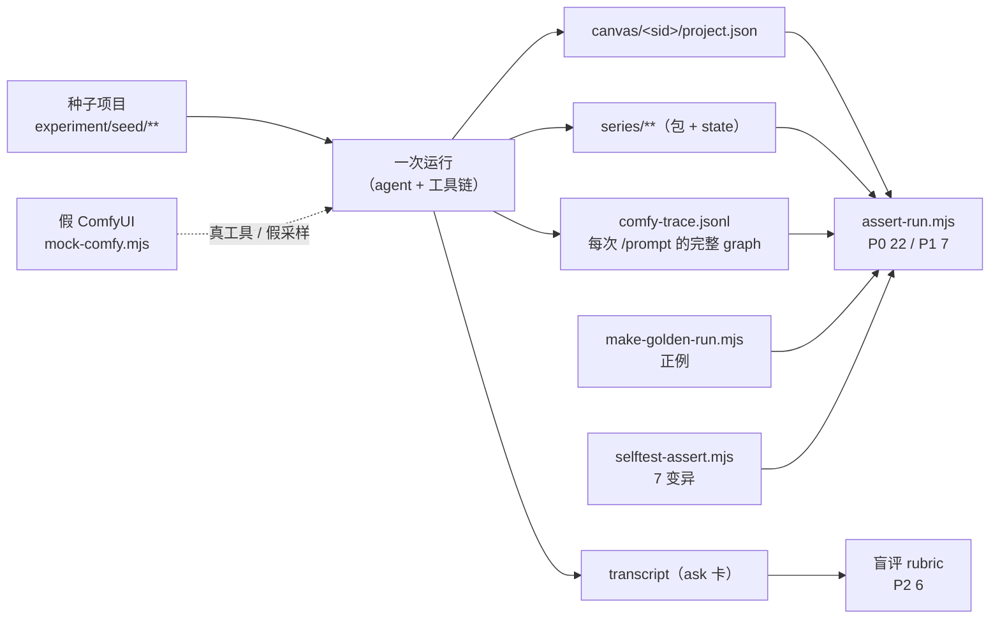

# 实验：三个 skill 的运行时一致性验证

> 目标：证明「WRI → PROD → SSG」这条连续短剧流水在**真实 agent + 真实工具链**下，按 skill 文本的意图运行。
> 状态：**L1 已完成（3 臂全过 P0）** · **L2 已完成（真机 8 镜 + 拼接零重编码）** · **L3 已完成（6/6 注入被拦）**。结果见 [l1-results.md](l1-results.md)、[l2-results.md](l2-results.md)、[l3-results.md](l3-results.md)；L4 续跑/变更待跑。
> 相关：[流程说明](../series-production-flow.md) · [契约审计](../analysis/contract-conflicts.md) · [人工门清点](../analysis/flow-and-human-gates.md)

---

## 0. 一句话

**skill 是提示词，不是代码**——"它符不符合预期"只能靠**观察一次运行的产物、参数与门序列**来判。
所以实验分两层：能用机器判的（产物 / 参数 / trace / 门禁）全部脚本化；只有"卡片话术、异常处置是否当场打断"留给盲评。

---

## 1. 「符合预期」的操作化定义

把三份 skill 的硬约束拆成三层，每层有独立的判据与装置：

| 层 | 断言来源 | 判据 | 谁来判 |
|---|---|---|---|
| **契约层** | `schemas/` + 三份 `SKILL.md` 的硬规则 | 静态可判：`npm run smoke`（61 项）+ `validate-episode-package`（六节/beat/assetMode）+ 文本契约断言 | 脚本（已有，回归用） |
| **行为层** | 流程图的顺序、门、参数、续接链 | **运行后**的 `project.json` / `series/**` / `comfy-trace.jsonl` | `assert-run.mjs`（P0 22 条 + P1 7 条） |
| **交互层** | 3 张卡、异常门、话术 | transcript（对话 + ask 卡） | 盲评 rubric（P2 6 条） |

**P0 = 违反即不合格**（硬约束：档位、续接、台词逐字、自检留痕、拼接顺序、状态推进…）。
**P1 = 预期行为**（应满足，失败记入报告但不阻塞）。
**P2 = 需要人/评审模型读 transcript**（卡片顺序与内容、异常是否当场打断、有没有静默降级）。

---

## 2. 为什么分层（不能只跑一次真机）

| 约束 | 后果 |
|---|---|
| 单镜 `balanced` ≈166 s，一集 8 镜 ≈22 min | 一次真机臂 ≈30 min，多臂跑不起 |
| LLM 非确定 + skill 文本会被 `~/.dsh` 缓存 | 同一 prompt 不能复现 → 需要固定装置 + N 次采样 |
| 失败往往在细节（一个 `continuityFrom`、一段字幕声明） | 人眼看成片看不出来，必须看**trace 里实际发出去的 graph** |
| 门禁（镜头表一致性 / shotGate）是代码，值得单独测 | 用故障注入验证"该拦的真的拦了" |

---

## 3. 实验装置（已实现，`scripts/experiment/`）



| 文件 | 作用 | 现状 |
|---|---|---|
| `scripts/experiment/mock-comfy.mjs` | 假 ComfyUI：真工具链、假采样；**记录每次 `/prompt` 的完整 graph** 与上传次数 | ✅ 自检通过 |
| `scripts/experiment/selftest-mock.mjs` | 证明「假 ComfyUI + 真工具链」可用（生成 1 张图 → 画布落盘 → trace 命中） | ✅ 6/6 |
| `scripts/experiment/seed/` | 种子项目（圣经 + 第 1 集剧本 + 8 镜集制作包 + state），包校验 0 error | ✅ |
| `scripts/experiment/make-golden-run.mjs` | 合成一份「应当全过」的运行，作为判分器**正例控制组** | ✅ 22/22 + 7/7 |
| `scripts/experiment/assert-run.mjs` | 机器判分器（读 project.json / series / trace） | ✅ 空运行 0/22（不空过） |
| `scripts/experiment/selftest-assert.mjs` | **负例控制组**：注入 7 种违规，验证判分器抓得住 | ✅ 变异杀死 7/7 |

> 三个 `selftest` 是这次实验的「元验证」：**判分器本身先要被验证**，否则"全过"没有意义。

---

## 4. 五层实验

| 层 | 假设 | 装置 | 执行者 | 样本 | 判定 | 成本 |
|---|---|---|---|---|---|---|
| **L0 契约回归** | 改动没破坏文本契约 | `npm run smoke` + `validate:bridge` + 种子包校验 | 脚本 | 1 | 全绿（61 + 0 error） | 秒级 |
| **L1 干跑（mock）** | agent 能在零 GPU 下走完单集流水，产物与参数合格 | 种子 + mock + 全新会话 | agent | **3**（同 brief，不同会话） | P0 全过（3/3），P1 ≥ 6/7 均值 | ~5 min/次 |
| **L2 真机单集** | 真 ComfyUI 下同样流程成立，且质量可用 | 真 ComfyUI + 同一 agent 流程 | agent | **1** | P0 全过；人工看 8 镜 | ~30 min GPU |
| **L3 故障注入** | 代码门与 skill 的异常门真的拦得住 | `scripts/experiment/l3-inject.mjs`（真门禁 + mock） | 脚本 | 6 | 每个注入 **都被拦**，且理由点名正确规则 | ~10 s |
| **L4 续跑与变更** | 断点续跑不重渲、剧本变更按 L1–L4 传播 | L1 装置 + 人为中断 + 改稿 | agent | 2 | 已完成镜不重渲；下游链顺次重渲 | ~8 min/次 |

### 4.1 L1 干跑（主力臂）

```
① 复制种子 → experiment/runs/L1-a/（每臂独立工作区，避免互相污染）
② 起 mock：MOCK_COMFY_PORT=8301 MOCK_COMFY_OUT=experiment-out/L1-a node scripts/experiment/mock-comfy.mjs
③ 全新 agent 会话 + 运行简报（见 §5），DSH_SVS_COMFY_URL=http://127.0.0.1:8301
④ 按答案卡回答 3 张卡（不许临场发明答案）
⑤ 收证据 → node scripts/experiment/assert-run.mjs --workspace … --session … --trace … --tier fast
```

### 4.2 L3 故障注入矩阵（验证「拦得住」，不是「做得对」）

| # | 注入 | 期望行为 | 观测点 |
|---|---|---|---|
| F1 | 跳过 G-A 直接渲片段 | 停线（`assetMode=library` 缺 asset id / 部署期拦） | 是否出现生成调用 |
| F2 | `tier=fast` + 三视图角色卡 | **拒绝渲染**，给 G-ref 四出路 | trace 里没有该次 `/prompt` |
| F3 | 项目字幕 `none`，但 prompt 写「烧录字幕」 | 自检/门 3 判失败；终检"无字幕"不通过 | 片段 `selfCheck` / 终检结论 |
| F4 | 改台词但不改镜头表 | **镜头表一致性门 deny**（台词逐字） | pre-execute 的 deny 记录 |
| F5 | 跨集传 `continuity_from` | 显式报错「上一镜没有链式序号」/ 无跨会话 latent | 工具返回 |

> F4/F5 也可以**纯脚本**跑（不走 agent）：直接调工具，断言 deny。这样 L3 有一半是确定性的。

---

## 5. 运行时协议（让"一次运行"可比较）

1. **一次运行 = 一个全新会话 + 一个独立工作区目录**（画布是 per-session，复用会串）。
2. **skill 文本固定**：把 `skills/` 的 git 提交号写进运行简报；**注意** `~/.dsh/skills/` 是插件安装副本，**改完必须重启 DSH 才会刷新**，否则跑的是旧文本（本轮已踩）。未重启时，简报里明确要求「以仓库 `skills/` 为准，不要用 `skill` 工具加载」。
3. **答案卡固定**（预写，不许临场决定）。本实验 3 张卡的标准答案：
   - 方案卡（G-P）：**批准开渲**；
   - 片段卡（batch）：**全部批准并进入拼接**（口型/听核项写"人工另行听核"）；
   - 交付卡（G-E）：**批准交付**。
4. **实验约束写进简报**：单集 45s / 8 镜（`episodeSecondsException`）、`tier=fast`、`reviewMode=batch`、`shotGate=verdict`、`characterCardVariant=single`、字幕 `none`。
5. **禁止项**（写进简报，否则跑的不是要测的东西）：不许跳阶段、不许改台词、不许改包、不许手工造画布节点、不许自创 beatId、不许删自检。
6. **证据必须全量保留**：`project.json`、`series/**`、`comfy-trace.jsonl`、transcript、（可选）截图。运行目录不清理。

---

### 5.1 真机臂的取证缺口

真机没有 mock trace ⇒ 「无重复提交 / 参考图已上传 / 无字幕声明 / prompt 完整」四条改用**片段参数代理**，其中「无重复提交」只能 SKIP。要根治就在真 ComfyUI 前加一个记录 `/prompt` 的代理（与 mock 同格式，约 1 小时）。

### 5.2 本轮实测暴露的装置假设（已改）

判分器第一版有 6 处假设被 L1 打穿，全部已修（详见 [l1-results.md](l1-results.md) §2C）：空集判过、续接列字段不存在、调用数口径、单根假设、i2v 无 `ref_variant`、转场镜命名。**这也是为什么控制组（正例 + 变异）必须先于被测对象通过。**

## 6. 判据明细

### 6.1 P0（22 条，机器判）

| 组 | 条目 | 为什么是关键 |
|---|---|---|
| 设置 | 9:16 / `reviewMode=batch` / `characterCardVariant=single` / `groupOrder`=10 组 | state 写错 → 门数从 3 张变 20 张 |
| 资产 | 角色卡 single/three **双向配对** | 配对断了 → `ref_variant` 换版失效 |
| 镜头表 | 七列可解析 / 每镜有 `剧本依据 B0x` / 编号 ⊆ 包 / 每个 beat 至少 1 镜 | 剧本覆盖的唯一机械证据（Q2 已修） |
| 提示词库 | 每镜一份、**三档同文** | 换档不换 prompt 的前提 |
| 片段 | 每镜都有 / 档位一致 / fast 必 single / `length/24 ≈ 表时长` / 续接链与表一致 | 混档与断链是量产最贵的错 |
| 自检 | 每镜 `selfCheck=pass` 且有抽帧 | shotGate 的放行凭据 |
| 收口 | 拼接顺序 = 镜头表 / state=delivered / doneShots 齐 / 成本记账 | 断点续跑与台账的可信度 |
| 调用 | 调用数 ≤ 1.5×镜数 / 参考图确实上传过 | "没有重复提交未改动的请求" |

### 6.2 P1（7 条）

表台词与包逐字一致 · 对白镜 `audio_ref_nodes` 与表一致 · `no subtitle` 负向尾句 · 台词出现在该镜 prompt · 无多余字幕声明 · 场景卡存在 · 每次生成都有完整 prompt。

### 6.3 P2（6 条，盲评）

1. 人工卡**恰好 3 张**、顺序 = 方案 → 片段 → 交付；
2. 方案卡里同时有 包①③⑤⑥ + 镜头表 + 分镜 + 渲染参数 + 成本（不是拆成 5 张）；
3. 异常（口型/字幕/3 次失败）**当场**弹卡，不压到批量卡；
4. **没有静默降级**（跳卡、改台词、少拍一镜、把 `text-only` 说成 `existing`）；
5. 回复里**不出现工作流 id / 模型名**（只报能力 + 档位 + 尺寸）；
6. 交付说明含：档位 / 交付尺寸 / 集间硬切 / 听核项 / 成本。

---

## 7. 通过标准

| 层 | 通过 |
|---|---|
| L0 | 全绿 |
| L1 | 3 臂 **P0 全过**；P1 均值 ≥ 6/7；P2 ≥ 5/6 |
| L2 | P0 全过 + 人工看片无"不可交付"级问题 |
| L3 | 5/5 注入被拦（**不得有静默放过**） |
| L4 | 不重渲已完成镜；变更按级传播 |

**判分口径**：P0 不允许平均——任一无过即该臂不合格；报告要列**失败条目 + 证据路径**，而不是一个分数。

---

## 8. 有效性威胁（必须写进报告）

1. **LLM 非确定**：N=3 只能给"是否稳定重复出现"，不能给置信区间；出现 1/3 失败按**不稳定**处理。
2. **skill 文本缓存**：`~/.dsh/skills/` 未刷新时跑的是旧文本 → 报告必须写 skill 来源 hash。
3. **mock 媒体不可播放**：L1 只验证流程与参数，**不验证观感/画质/音频**；观感只在 L2。
4. **mock 的"实现可用性"恒为真**：L1 不覆盖"设置页档位指到不可用实现"这类配置错误。
5. **单机串行**：并发多臂会共享 ComfyUI 队列/显存，必须串行或分端口。
6. **P2 盲评**：评审者不应看到实验假设（只给 transcript + 产物清单）。

---

## 9. 执行清单

**今天就能跑（零 GPU）**

```bash
npm run experiment:selftest      # 装置自检：mock + 正例 + 变异（≈10 s）
npm run experiment:golden        # 生成/刷新正例运行
npm run experiment:assert -- --workspace experiment/golden --session golden-session \
  --trace experiment/golden/comfy-trace.jsonl --tier fast
```

**跑 L1 三臂**

1. `cp -R experiment/seed experiment/runs/L1-a`（b/c 同理）；
2. `MOCK_COMFY_PORT=8301 MOCK_COMFY_OUT=experiment-out/L1-a node scripts/experiment/mock-comfy.mjs &`；
3. 新会话 + §5 简报 + 答案卡；
4. `npm run experiment:assert -- --workspace experiment/runs/L1-a --session <sid> --trace experiment-out/L1-a/comfy-trace.jsonl --tier fast`。

**注意**：L1 需要 agent 会话；本机 `~/.dsh/skills/` 未刷新时，简报要显式指向仓库 `skills/`。

---

## 10. 预算

| 层 | 墙钟 | GPU |
|---|---|---|
| L0 | < 1 min | 0 |
| L1 × 3 | ~15 min | 0（mock） |
| L2 × 1 | ~30 min | ≈22 min |
| L3 × 5 | ~15 min | 0（mock）+ 2 条纯脚本 |
| L4 × 2 | ~16 min | 0 |
| P2 盲评 | ~30 min 人工 | — |
| **合计** | **≈2 h 人工 + 25 min GPU** | |
