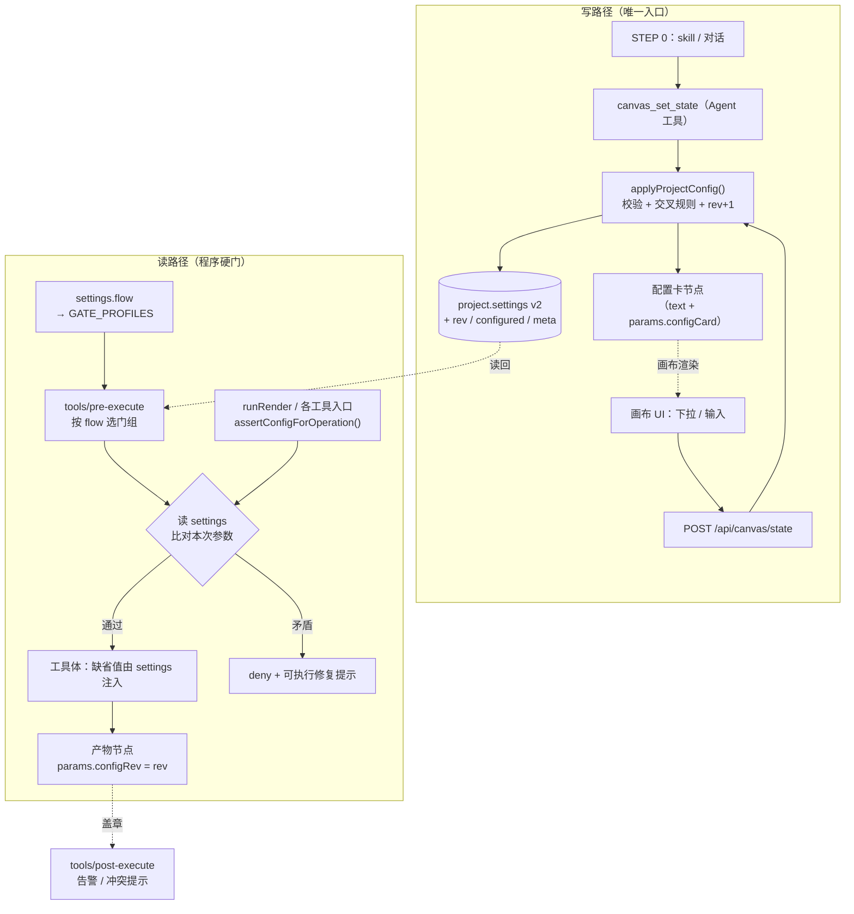

# 画布项目配置卡 + 配置硬门（设计方案 v0.2，待审核）

> 目标：把 STEP 0 的选择从「对话里的口头约定 / 项目简报里的散文」提升为**画布上的结构化配置**——用户看得见、改得动；Agent 每次生成 / 后处理 / 写画布前，程序都从画布读配置，缺省值按配置注入、矛盾直接 deny、配置变更后的旧产物也 deny。
>
> 适用范围：单片（story-short-generator）、连续短剧（short-drama-series-production 的每一集），以及后续新增片型（品牌 / 电商等，通过 §10 的门组机制接入）。
>
> 状态：**P0 已实施 + P1 部分落地**（2026-11-09：settings v2 / flow 推断 / applyProjectConfig / 配置卡 / 画布面板 / `POST /canvas/state` / R1·R2·R3·R12 / rev；另已接 `gateOn` 流程门、R6·R8·R9 漂移门、`configRev` 盖章）。剩余 P1（post-execute 简报告警、tierOverride 标记）与 P2 见 §14。

---

## 0. 一句话方案

**一张配置卡（画布节点）+ 一份配置状态（`project.settings` v2 + `rev` + `flow`）+ 一个写入口（`applyProjectConfig`）+ 两个钩子（`tools/pre-execute` 配置门 / `tools/post-execute` 盖章与告警）+ 一套门组（按 `flow` 选择，见 §10）。**

配置卡是给人看的、可改的；`project.settings` 是给程序读的唯一真相源；两者由同一个写函数原子更新，不会漂移。门分「契约门（永远开）」与「流程门（按片型开）」，新 skill 只声明片型，不定义门。

---

## 1. 现状与缺口

### 1.1 已有

| 能力 | 位置 | 现状 |
|---|---|---|
| 项目设置 | `lib/index.js` `emptyProject` / `loadProject` | 只有 6 个字段：`aspectRatio` / `duration` / `audioMode` / `mode` / `characterCardVariant` / `reviewMode` / `shotGate` / `groupOrder` |
| 设置读写 | `canvas_set_state` / `canvas_get_state` | 只有 Agent 工具能写；没有 HTTP 写入口 |
| 画布展示 | `studio/app.js:1024` 顶栏 `el.meta` | **只读摘要**，不能改 |
| 已有门 | `tools/pre-execute` | plan gate（镜头表一致性）、production gate（系列制片）、shot gate（逐镜自检）、H3 prompt gate；全部是全局监听，**没有「片型」维度** |

### 1.2 缺口

1. **6 项 STEP 0 参数没有 state 字段**：`imageTier` / `subtitles` / `delivery` / `style` / `bgmMode` / `voicePlan` 只写进项目简报正文，程序读不到，也就没法门控。
2. **配置不可在画布上改**：顶栏只读；用户改配置只能回对话让 Agent 调 `canvas_set_state`。
3. **没有任何门要求「本次操作 == 画布配置」**：plan gate 只是碰巧查了宽高比例与 fast+three，图片生成、后处理、卡片生成都不查；Agent 忘了传参时工具按自己的默认值走（图片默认 `quality`，视频默认 `quality`），与 STEP 0 的选择无关。
4. **改配置后旧产物不会失效**：把画幅从 16:9 改成 9:16，已出的角色卡/镜头表/片段仍然被继续引用，没有任何提示。
5. **系列层与单集层没有机器可读的继承/锁定关系**：系列圣经 §1 与集制作包 ⑥ 是文件里的散文，单集 `settings` 与它们是否一致只能靠 skill 自查。
6. **门没有片型维度**：所有门按工具名 + 画布状态全局激活。以后加电商 / 品牌 skill 时，H3 门与逐镜自检门会误伤，镜头表门 / 制片门会空转；见 §10。

---

## 2. 总体结构



**设计原则**

- **单一写入口**：`applyProjectConfig()` 是唯一能改配置的函数；工具、HTTP、迁移都走它，配置卡在同一事务里重写。
- **单一读入口**：`readProjectConfig(project)` 返回规范化后的配置（含默认值），工具与门读同一份。
- **门只判矛盾，不替用户做决定**：缺省值在工具体内按配置注入；门只拒绝「与配置明确冲突」的请求。
- **门分两类**：契约门（H3 结构 / 几何 / 写保护）永远开；流程门（镜头表 / 自检 / 制片 / 配置字段）按 `settings.flow` 选择，见 §10。
- **配置卡是投影，不是原件**：卡上的文字由 `settings` 生成；直接改卡文本被拒绝，改配置走控件。

---

## 3. 数据模型：`settings` v2

### 3.1 结构

```jsonc
{
  "settings": {
    // —— 画面 / 时长 ——
    "aspectRatio": "9:16",
    "duration": "90s",
    "audioMode": "dialogue-led",

    // —— 画质 / 成本 ——
    "mode": "balanced",            // 视频档位（已有）
    "imageTier": "balanced",       // 图片档位（新增）
    "delivery": "native",          // native | upscale1080 | upscale2k | upscale4k | regen2k | fps48（新增）

    // —— 资产 / 声音 / 字幕 ——
    "characterCardVariant": "single",
    "voicePlan": "existing",       // existing | audition | text-only（新增）
    "subtitles": "none",           // none | burned-in（新增）
    "language": "zh",              // zh | en | auto（新增）
    "style": "cinematic-live-action", // 视觉风格 id（新增）
    "bgmMode": "none",             // none | in-model（新增）

    // —— 审查 / 自检 ——
    "reviewMode": "per-shot",
    "shotGate": "verdict",

    // —— 展示 ——
    "groupOrder": ["项目配置", "story planning", "character cards", "..."],

    // —— 配置元宇宙（新增）——
    "flow": "story",               // story | series | brand | ecommerce | free（门组，见 §10）
    "rev": 3,                      // 单调递增；每次写 +1
    "configured": true,            // false = 尚未建配置卡（首次生成前会被拒，见 R12）
    "breakingRev": 2,              // 最近一次「破坏性字段」变更的 rev
    "meta": {
      "updatedAt": "2026-11-09T10:00:00.000Z",
      "updatedBy": "user",         // user | agent | package | migration
      "sources": { "aspectRatio": "user", "style": "package" },
      "locked": ["aspectRatio", "style"]   // 系列层锁定字段（可选）
    },
    "series": { "id": "…", "episode": "ep001", "packageVersion": 1 }
  }
}
```

### 3.2 兼容规则

- 老 `project.json` 缺字段 → `normalizeSettings()` 补默认值；`configured` 缺省 `false`（尚未建卡；首次生成会被 R12 拒一次，按提示建卡后放行）。
- `flow` 缺省按结构一次性推断并写回：有 `series/production-state.json` 或 `settings.series` → `series`；画布有七列镜头表 → `story`；否则 `free`。**不能一律默认 `free`**——存量故事项目会因此丢掉 plan / shot 门。
- `rev` 缺省 `0`；`breakingRev` 缺省 `0`。
- `duration` 保持字符串（兼容现有 skill 写法），门里按「秒数」解析（`90s` / `90 秒` / `1:30`）。
- `groupOrder` 保持不变；写入时把 `"项目配置"` 补到首位（已存在则不重复）。

### 3.3 字段语义与影响

| 字段 | 值域 | 缺省 | 谁读它 | 改动影响 |
|---|---|---|---|---|
| `flow` | `story` / `series` / `brand` / `ecommerce` / `free` | 按结构推断（见 §3.2） | 门组选择（§10） | **破坏性**：门组与配置字段 schema 变化；需重走该片型的 STEP 0 |
| `aspectRatio` | 任意 `W:H`（UI 给 16:9 / 9:16 / 1:1 + 自定义） | `16:9` | 全部图片/视频尺寸推导 | **破坏性**：已出卡片/分镜/片段全部比例不对 |
| `duration` | 字符串 | `""` | 镜头预算、时长核对 | 破坏性：镜头表预算重算 |
| `audioMode` | `silent` / `dialogue-led` / `narration-led` | `silent` | 对白、声线、BGM 声明 | **破坏性**：已出片段的对白/声线不匹配 |
| `mode` | `fast` / `balanced` / `quality` | `quality` | 视频档位 | 非破坏性（逐镜可覆盖） |
| `imageTier` | 同上 | `balanced` | 卡片 / 分镜图 | 非破坏性（已有卡片仍有效） |
| `delivery` | 6 个枚举 | `native` | 终检 / 后处理步骤 | **破坏性**：交付路线变化 |
| `characterCardVariant` | `single` / `three` | `single` | 每镜 `ref_variant` | **破坏性**：身份形态变化 |
| `voicePlan` | 3 个枚举 | `existing` | 声线试镜 | 破坏性：声线锚点变化 |
| `subtitles` | `none` / `burned-in` | `none` | prompt 字幕声明、核对 | **破坏性**：提示词与成片是否带字 |
| `language` | `zh` / `en` / `auto` | `auto` | 台词语言 | 破坏性：台词/字幕 |
| `style` | 7 个风格 id | `""` | 风格锁后缀、卡片 | **破坏性**：全部卡片/片段作废 |
| `bgmMode` | `none` / `in-model` | `none` | 镜头表 BGM 子字段、prompt | 破坏性：BGM 有无 |
| `reviewMode` / `shotGate` | 枚举 | `per-shot` / `verdict` | 流程门 | 非破坏性（只影响后续） |

> 「破坏性字段」集合 = 表中标 **破坏性** 的字段，落地为常量 `BREAKING_FIELDS`。改这些字段 → `breakingRev = 新 rev`。

---

## 4. 配置卡节点

### 4.1 形态

**v1：`kind: "text"` + `params.configCard: true`**（不新增节点 kind，避免扩散到上传/入库/PDF/送达/分组等所有 kind 分支）。

- 稳定 id：`cfg-<sessionId>`（幂等，重复写不会产生多张卡）。
- 分组：`项目配置`，`groupOrder` 首位。
- 节点字段：

```jsonc
{
  "id": "cfg-<sessionId>",
  "kind": "text",
  "title": "项目配置（STEP 0）",
  "group": "项目配置",
  "content": "## 项目配置 …",   // 由 settings 生成，只读
  "params": {
    "configCard": true,
    "configRev": 3,
    "config": { "...": "settings 快照（含 rev）" },
    "noAutoDeliver": false
  }
}
```

- `content` 由 `renderConfigMarkdown(settings)` 生成：一张「项 / 值 / 来源 / 改动影响」表 + 版本行 + 「本卡由系统维护」说明。
- 文本节点现成的 PDF 导出 / 飞书送达链路可直接复用（`lib/index.js` `exportTextNode` + `collectUndelivered`）；`upsertConfigCard` 里要像 `canvas_write_node` 一样调一次 `exportTextNode` 生成 `node.file`（失败不影响保存，只记 warning），否则卡不会进入自动送达队列。

### 4.2 同步规则

- `applyProjectConfig()` 内：更新 `settings` → 重新生成卡 `content` / `params` → **同一次 `saveProject`** 落盘。任何写路径都不会出现「settings 改了、卡没改」。
- 卡被删除：下次任意写配置或 `canvas_get_state`（`configured=true` 时）自愈重建，并记一条 warning。
- 卡内容被直接 POST 改：`POST /api/canvas/node` 对 `params.configCard === true` 的节点做写保护——**只允许改 `group` / `order`，拒绝改 `content` / `params`**，返回 400 并提示「请用配置面板或 canvas_set_state」。

### 4.3 送达

- 首次创建 / STEP 0 完成时随下一次 `ask_user_question` 自动送达 PDF（现有机制）。
- 后续编辑：默认**不重复送达**（保留 `params.deliveredAt`）；面板提供「发送到飞书」按钮（P2 可选）。
- 待拍板（§15-Q4）。

---

## 5. 画布 UI

### 5.1 顶栏

- 把只读 `el.meta` 右侧加一个 `⚙ 配置` 按钮（`studio/app.js`），摘要保留。
- 点击打开配置面板（居中模态，复用现有 `modal()` 基础设施）。

### 5.2 配置面板（下拉 / 输入）

| 分组 | 控件 |
|---|---|
| 项目 | 片型 `flow` `select`（story / series / brand / ecommerce / free；通常由 skill 声明，手动切换需确认并重走该片型 STEP 0） |
| 画面 / 时长 | 画幅 `select`（16:9 / 9:16 / 1:1 / 自定义）；总时长 `select`（15/30/60/90/120s / 自定义 `input`） |
| 画质 / 成本 | 视频档位 `select`（fast/balanced/quality）；图片档位 `select`；交付画质 `select`（原生 / 1080 / 2K / 4K / regen2k / 48fps） |
| 资产 / 声音 | 角色卡版本 `select`（单视图 / 三视图；`mode=fast` 时三视图禁用并提示）；声线方案 `select`；字幕 `select`（无 / 画面内）；语言 `select`；视觉风格 `select`（7 套）；BGM `select` |
| 审查 / 自检 | 审查节奏 `select`（逐镜 / 批量）；自检门 `select`（开启 / 抽帧 / 关闭） |

控件旁的说明文案直接来自 §3.3 的「改动影响」列；系列锁定字段显示 🔒 并禁用。

### 5.3 影响预览（保存前）

选中改动后，面板底部列出：

```
将改动：画幅 16:9 → 9:16（破坏性）
受影响：角色卡 2 张、场景卡 1 张、镜头表 1 张、已出片段 3 条
后果：上述产物需重建/重渲；已产出的片段不会自动删除。
[取消] [仍然保存]
```

- 计数由前端从 `project.nodes` 按 `kind` / `params` 统计（够用）；服务端保存时再算一次权威 `impact` 返回。
- 非破坏性字段改动不弹确认。

### 5.4 保存与并发

- 面板打开时记下当前 `rev`；保存发 `POST /api/canvas/state`，body `{ patch, expectedRev }`。
- 服务端 `expectedRev !== settings.rev` → **409**，返回最新 `settings`；前端提示「配置已被 Agent 更新」并刷新面板，不覆盖。
- 保存成功 → 重渲染画布（卡 + 顶栏摘要）。

### 5.5 空态

- `configured=false`：顶栏显示「未配置」；面板提供「按推荐默认值创建配置卡」（创建即 `configured=true`）。
- 未建卡前，**首次生成会被配置门拒绝一次**（Q3 决定）：deny 信息给出 `canvas_set_state(flow=…, …推荐默认值)` 的精确调用；建卡后按配置执行。
- 一次性生成也一样要先建卡（低摩擦：建卡只需一次工具调用，字段可用默认值）。

---

## 6. 写路径：`applyProjectConfig()`

```js
async function applyProjectConfig(root, sid, patch, { source = 'agent', expectedRev } = {}) {
  const project = await loadProject(root, sid)
  const prev = normalizeSettings(project.settings)
  if (expectedRev != null && expectedRev !== prev.rev) {
    throw new HttpError(409, { message: '配置已被更新', settings: prev }) // 前端提示刷新
  }
  const next = validateSettings({ ...prev, ...patch })   // 枚举 / 值域
  // 交叉规则
  if (next.mode === 'fast' && next.characterCardVariant === 'three') {
    next.characterCardVariant = 'single'                 // 沿用现有行为，追加 warning
  }
  if (next.subtitles === 'burned-in' && next.mode !== 'quality') {
    warnings.push('画面内字幕建议 quality 档（fast/balanced 实测不稳）')
  }
  const changed = diffFields(prev, next)
  if (changed.length) {
    next.rev = prev.rev + 1
    if (changed.some((f) => BREAKING_FIELDS.has(f))) next.breakingRev = next.rev
    next.meta = { ...prev.meta, updatedAt: new Date().toISOString(), updatedBy: source }
    next.meta.sources = { ...prev.meta?.sources, ...Object.fromEntries(changed.map((f) => [f, source])) }
  }
  next.configured = true
  project.settings = next
  upsertConfigCard(project, next)                        // 同一事务
  await saveProject(root, sid, project)
  return { ok: true, rev: next.rev, changed, warnings, cardNodeId: CONFIG_CARD_ID(sid), impact: computeImpact(project, changed) }
}
```

- `canvas_set_state` 的 `execute` 改为调用它（保留现有返回字段，新增 `rev` / `cardNodeId`）。
- 新增 `POST /api/canvas/state`（走 studio token），body `{ patch, expectedRev }`，返回同上。
- `canvas_get_state` 返回 `{ settings, rev, configured, cardNodeId }`。
- 不加新 Agent 工具（避免工具面膨胀）；`canvas_set_state` 即写入口。

---

## 7. 读路径：配置硬门（`tools/pre-execute`）

### 7.1 结构

- 新增 `makeConfigGateListener(ctx)`，注册在现有门**之前**（配置是上游；先报配置问题，避免 agent 在错误的画幅上反复调镜头表）。Cordis waterfall 的实际调用顺序以注册顺序为准，落地时用一条冒烟断言「同时命中 config gate 与 plan gate 时先报配置」来锁定。
- 与现有门一样：`global: true`、任何异常放行、连续 deny 有上限（见 §7.6）。
- 门的核心函数抽成 `assertConfigForOperation(project, op, args)`，**同一份逻辑**也被 `runRender` / HTTP `/generate/*` 调用——因为 `tools/pre-execute` 只覆盖 Agent 工具调用，覆盖不到画布 HTTP 生成入口。
- **只把配置字段检查做成流程门**（受 `gateOn(settings, 'config')` 控制）；几何 / 形态 / 写保护属于契约门，在任何 `flow` 下都开（见 §10）。

### 7.2 门控对象

| 操作 | 工具 / 入口 |
|---|---|
| 图片生成 | `comfy_generate_image`、`comfy_render`（`image.*`）、`POST /generate/image` |
| 视频生成 | `comfy_generate_video`、`comfy_render`（`video.*` 排除后处理）、`POST /generate/video` |
| 视频后处理 | `video_upscale` / `video_regenerate` / `video_interpolate` / `video_concat` |
| 画布写入 | `canvas_write_node`（配置卡写保护、简报冲突检测）、`canvas_write_prompt_bank`（盖章） |
| 音乐 | `comfy_generate_music`（BGM 模式声明，warning 级） |

### 7.3 规则表

| # | 检查 | 判定 | 动作 |
|---|---|---|---|
| R1 | 显式 `width/height` 与 `aspectRatio` 不一致 | 比例偏差 > 1% | **deny**：「请求 1920×1080 ≠ 画布 9:16；去掉 width/height 按配置推导」 |
| R2 | `ref_variant=three` 且 `mode=fast` | — | **deny**（沿用现有 plan gate 规则，但覆盖图片/无 Sxx 的生成） |
| R3 | `ref_variant=three` 且 `characterCardVariant=single` | 非 fast | **deny**：「STEP 0 选的是单视图；要用三视图请先在配置卡改」 |
| R4 | `ref_variant=single` 且 `characterCardVariant=three` | — | **allow**（这是文档规定的污染回退路径） |
| R5 | 显式 `tier` 与 `mode` / `imageTier` 不同 | — | **allow + 标记**：产物 `params.tierOverride = {requested, configured}`，结果里加一行 warning（升档重渲是失败梯度的一部分，不能硬拦） |
| R6 | 镜头表节点 `configRev < breakingRev` | — | **deny**：「配置 rev N 改了画幅；镜头表还是 rev M 写的，先重建镜头表」 |
| R7 | 提示词库节点 `configRev < breakingRev` 且变更含 `style` / `subtitles` / `audioMode` | — | **deny**：「提示词库按旧风格/字幕写的，先重写本镜提示词库」 |
| R8 | 片段节点 `configRev < breakingRev`（`video_concat` 时） | — | **deny**：「配置变更后旧片段需重渲，或先接受混版」 |
| R9 | 参考卡节点 `configRev < breakingRev` 且变更含 `aspectRatio` / `style` / `characterCardVariant` | 卡有 `configRev`（非资产库引用） | **deny**：「角色卡是按旧画幅/风格出的，先重出卡片」 |
| R10 | 后处理（upscale/regenerate/interpolate）与 `delivery` 不一致 | — | **allow + warning**（用户显式后处理是意图，记入产物参数） |
| R11 | 系列锁定字段被单集 settings 覆盖 / 与系列状态不一致 | 有 `settings.series` | **deny**：「系列圣经锁定 9:16；要改请在系列层改」 |
| R12 | `configured=false`（无配置卡） | 任何图片/视频/音乐生成、视频后处理 | **deny**：「先建配置卡：`canvas_set_state(flow=…, …推荐默认值)`；建卡后按配置执行」 |
| R13 | 当前 `flow` 的 profile 未启用该**流程门** | — | **skip**（契约门不受此限，见 §10） |
| R14 | `flow` 缺失/未知 | — | 按 `free` 处理：只跑契约门 + 一条 warning |

> R1/R2 与现有 plan gate 重叠：plan gate 保留（它做逐字台词/字幕/时长/声线比对），config gate 只做上述检查；两者都 deny 时以先注册者为准，避免同一次调用出现两条冲突提示。

### 7.4 缺省值注入（不在门里，在工具体）

门只判矛盾，不做修改（`exec.arguments` 是冻结的）。缺省值由工具体读 `settings`：

- 视频：`tier` 缺省 → `settings.mode`；`ref_variant` 缺省 → `settings.characterCardVariant`（fast 强制 single）。
- 图片：`tier` 缺省 → `settings.imageTier`。
- 宽高：已有逻辑按 `aspectRatio` 推导，保持。
- 时长：`length` 缺省仍 124（镜头表权威），不按总时长猜。

这样即使 Agent 忘传参，实际使用的也是用户在画布上选的值。

### 7.5 门组前置（profile）

每个**流程门**开头先判断本片型是否启用该门：

```js
if (!gateOn(project.settings, 'plan')) return next()
```

- `gateOn` 读 `settings.flow` → `GATE_PROFILES`（门目录在插件代码里，见 §10）。
- **契约门**（H3 结构 / 几何 / 写保护）不加这一行，任何片型都开。
- 未知 `flow` 按 `free` 处理：只跑契约门 + 一条 warning；但「无配置卡先建卡」（R12）仍适用。

### 7.6 防死循环

- 沿用现有门的模式：同一 agent 连续 deny ≥ 3 次 → 降级放行，并把 `params.configGateWarning` 写进本次产物，画布卡片显示 ⚠️。
- 与 shot gate 的 2 次不同：配置是硬事实，给 agent 多一次改配置的机会，但仍保留逃生阀（否则一次错误配置会卡死会话）。
- 测试 / 脚本逃生阀：`DSH_SVS_CONFIG_GATE=off`（类比 `DSH_SVS_PRODUCTION_GATE`）；冒烟默认显式建卡，不依赖逃生阀。

---

## 8. 后置钩子（`tools/post-execute`）

> `tools/post-execute` 是 DSH 原生 waterfall（`dsh-tools` events），可以替换 / 补充结果内容，适合「已经发生、要提醒」的检查。

| 触发 | 检查 | 动作 |
|---|---|---|
| 任意生成成功 | 产物节点是否已带 `params.configRev` | 没带则补写（兜底 `runRender` 漏掉的分支） |
| `canvas_write_node` 写的是配置卡 | 写保护（见 §4.2） | 应放在 pre-execute；post 只兜底警告 |
| `canvas_write_node` 写的是项目简报 / 集制作包 / 本集规格 | 解析正文里的规格行（`画幅 9:16`、`档位 balanced`、`字幕 none`…）与 settings 比对 | 不一致 → 在结果尾部追加一行 `⚠️ 配置冲突：简报写 X，配置卡是 Y`（不阻断、不改节点），让 Agent 当场修正 |
| `canvas_write_prompt_bank` | 写入成功 | 给提示词库节点盖 `params.configRev = settings.rev` |
| `video_concat` / 后处理成功 | 产物带 `params.configRev` | 盖当前 rev，供后续漂移检查 |

简报解析只做**严格键值行**（`^-\s*(画幅|档位|图片档位|字幕|交付|风格|审查|自检)\s*[:：]\s*(.+)$`），解析不出就跳过——不猜自由文本，避免误报。

---

## 9. 系列模式（连续短剧）

### 9.1 三层配置

```
系列圣经 §1（series/production-state.json · series spec）
        │  启动每集时继承
        ▼
集制作包 ⑥（episodes/epNNN/package.md · 只读交接物）
        │  委托模式 STEP 0 预填
        ▼
单集画布 settings（本项目 · 可改非锁定字段）
```

### 9.2 继承与锁定

- 委托模式开始时，`story-short-generator` 读 package ⑥，用 `canvas_set_state` 一次写全（现有行为），`source='package'`，`settings.series = { id, episode, packageVersion }`。
- 系列层规定的字段（画幅 / 档位 / 字幕 / 风格 / 角色卡版本 / 交付路线）写入 `meta.locked`，画布面板显示 🔒 只读；要改必须在系列层改，并触发「已产集作废」确认（系列 gap 不在本次范围，见 P2）。
- 配置卡顶部显示：`来源：系列圣经 vN · 集制作包 ep001 v1`。

### 9.3 一致性门

- 视频生成前，若 `settings.series` 存在：读 `series/production-state.json`，比对锁定字段；不一致 → deny（R11）。
- `packageVersion` 与当前文件不一致 → 配置卡标「过期」，视频生成 deny：「制作包已更新到 v2，先重写配置卡」。
- 这一层可以并入现有 production gate，不新增独立门，避免门过多。

---

## 10. 多 skill / 门组（profile）

> 回答两个问题：以后加一个电商 skill，现有门会怎样？能不能让一个 skill「配一套门」？

### 10.1 问题：门没有「片型」维度

现有门都是 `{ global: true }` 的全局监听器，按**工具名 + 画布/工作区状态**自激活：

| 门 | 现在的激活条件 | 电商 skill 直接复用会怎样 |
|---|---|---|
| H3 结构门 | workflow 前缀 `minimax-h3-`，prompt 非空且无 `[PROMPT_FALLBACK]` | **会拦**：走 H3 就必须六段式；不加载 `h3-prompt-writing` 会连续 deny 后降级 |
| 镜头表门（plan） | 画布存在七列镜头表，且标题含 `Sxx` | 不触发 |
| 制片门（production） | workspace 有 `series/production-state.json` | 不触发 |
| 逐镜自检门（shot） | 所有视频生成，且 `shotGate != off` | **会拦**：每镜必须 `canvas_record_check(pass)` 才能出下一镜 |
| pre-ask 送达 | 所有 `ask_user_question` | 会触发（把未送达节点发飞书） |
| 配置门（本方案） | `configured=true` | 无配置卡 → R12 拒绝；同会话先跑过故事 → 按故事字段误拦 |

结论：一半门空转、一半门误伤。根因是没有「片型」这个维度。

### 10.2 两类门

| 类别 | 判定依据 | 例子 | profile 能否关 |
|---|---|---|---|
| **契约门** | 模型 / 工具 / 画布契约 | H3 结构化、几何（宽高 vs 画幅）、配置卡/资产写保护、宿主 JSON schema | **不能**（换 workflow / 改工具才失效） |
| **流程门** | 片型流程 | 镜头表门、逐镜自检门、制片门、STEP 0 字段门、送达策略 | 能（按 profile） |

### 10.3 机制：skill 声明 flow，插件查表开门

```js
// 门目录在插件代码里；skill 只能选 profile，不能定义门
const GATE_PROFILES = {
  free:      ['h3'],
  story:     ['h3', 'plan', 'shot', 'config', 'deliver'],
  series:    ['h3', 'plan', 'shot', 'production', 'config', 'deliver'],
  brand:     ['h3', 'config:brand', 'shot'],
  ecommerce: ['h3', 'config:ecommerce', 'product-lock'],   // product-lock 需新写
}
function gateOn(settings, id) {
  const flow = GATE_PROFILES[settings.flow] ? settings.flow : 'free'
  return GATE_PROFILES[flow].includes(id)
}
```

- `settings.flow` 是**项目级**字段（不是进程级）：同一会话可能先跑故事、再跑电商，门必须跟画布走。
- skill 只多做一步：STEP 0 `canvas_set_state(flow='ecommerce', ...)`；其余流程照旧。
- 每个**流程门**开头 `if (!gateOn(settings, 'plan')) return next()`；**契约门**不加。
- 门的模型/能力定位（H3 前缀、capability）仍按原逻辑，profile 只决定「这门是否属于本片型」。
- `config:brand` / `config:ecommerce` 是配置门的片型变体：各自维护字段 schema（电商：商品图规格、平台画幅、LOGO 锁定、价格文案一致性），不套故事的 `style` / `characterCardVariant`。

### 10.4 失败安全

- **未知 flow**（skill 忘声明/拼错）→ 按 `free` 处理：只开契约门 + 一条 warning；**不默认全开**（新 skill 会被老流程门卡死），**不默认全关**（丢 H3/几何安全门）；「无配置卡先建卡」（R12）仍适用。
- 门自身异常 → `next()` 放行（沿用现有门的 try/catch 约定）。
- **profile 切换 = 破坏性变更**：`rev+1`、`breakingRev` 提升，旧产物标过期；UI 需确认（见 §5.3），并要求重走新片型的 STEP 0。
- 存量项目迁移按 §3.2 推断 flow，不一律落 `free`。

### 10.5 为什么不让 skill 自带门

| 做法 | 机制 | 问题 |
|---|---|---|
| **A. profile（推荐）** | skill 声明 `flow`，插件查表 | 门目录在代码里，可测试、可审计、不可被 prompt 绕过 |
| B. skill 自带 `gates.json` / `gates.js` | 安装时读取 / 加载 | skill 是用户可改文件；等于把安全边界交给 prompt 层；版本/信任/审计不可控 |
| C. 结构自动检测 | 每门 `appliesTo(project)` | 对 plan/production 够用；H3/shot 这类无条件门无法区分片型，且结构相似片型互相误判 |

折中（若确实要 skill 参与）：skill 只能**引用内置门 id**（`requiredGates: ['h3','product-lock']`），插件只认已知 id、未知忽略并 warning；仅作 profile 的补充。

### 10.6 测试矩阵

`profile × gate` 的期望开关表，冒烟断言：

- `ecommerce`：plan / shot / production 不触发；H3 契约门仍触发；`config:ecommerce` 触发。
- `story`：全部流程门按原行为。
- 未知 flow：只触发契约门 + warning。
- 切 flow：`rev+1`、`breakingRev` 提升、旧镜头表过期。

---

## 11. 配置漂移（configRev / breakingRev）

### 11.1 盖章

- 所有产物节点创建 / 更新时写 `params.configRev = settings.rev`（`runRender` 统一做，post-execute 兜底）。
- 镜头表（`findShotPlan` 识别的 table 节点）、提示词库、片段、卡片都参与。

### 11.2 判定

```
stale(node) = node.params.configRev != null
           && node.params.configRev < settings.breakingRev
```

- 只有「破坏性字段」变更才提升 `breakingRev`，非破坏性改动（档位、审查节奏、图片档位）不会让旧产物失效。
- 老节点没有 `configRev`（功能上线前生成）→ 不参与（grandfather），避免存量项目一开新版本就全红。
- 资产库引用（`params.assetId`）不参与漂移（跨集复用是设计意图），只参与 R9 的「本项目卡片」分支。

### 11.3 为什么需要它

用户改配置是这次需求的核心；如果改了配置旧产物还能继续用，等于配置没生效。漂移门是「配置可改」的另一半——**改了就真的按新配置走**。

---

## 12. 兼容与迁移

| 场景 | 行为 |
|---|---|
| 存量项目（无 `configured` / `rev`） | 尚未建卡：首次生成被 R12 拒一次，按提示用推荐默认值建卡；UI 保存或 `canvas_set_state` 也会升级 v2 |
| 存量项目（无 `flow`） | 按结构推断：series / story / free（§3.2）；不一律落 free |
| 存量节点（无 `configRev`） | 不参与漂移门 |
| 存量 assets（跨会话复用卡） | 不参与 R9；`characterCardVariant` 仍按配置换版 |
| 旧 skill 调用 `canvas_set_state` | 参数不变；额外创建配置卡、返回 `rev`，skill 不需要改 |
| 旧 `canvas_get_state` 调用方 | 返回对象多出字段，向后兼容 |
| 画布 HTTP 直接生成（`/generate/*`） | 走 `runRender` 内的 `assertConfigForOperation`，与工具门同一规则 |
| 一次性生成（无配置卡） | 首次被 R12 拒一次，建卡后放行（Q3 决定） |

---

## 13. 测试与验收

### 13.1 冒烟脚本（新增）

- `scripts/smoke-config-card.mjs`
  - `canvas_set_state` 后卡节点存在、`group=项目配置`、`groupOrder` 首位、`content` 含全部字段、`rev=1`
  - 再次保存 → `rev+1`、卡内容同步、无重复卡
  - 直接 `POST /canvas/node` 改卡 content → 400
  - `GET /canvas` 返回的 settings 与卡 `params.config` 一致
- `scripts/smoke-config-gate.mjs`
  - R1：显式 1920×1080 + 9:16 → deny；去掉宽高 → 放行
  - R2：fast + three → deny
  - R3：single + three（balanced）→ deny；three + single → 放行
  - R6：改 `aspectRatio` → 旧镜头表生成视频 → deny；重建镜头表 → 放行
  - R8：改 `style` → concat 旧片段 → deny
  - R12：无配置 → deny；按提示建卡后放行
  - 连续 deny 3 次 → 降级放行 + `configGateWarning`
- `scripts/smoke-config-profile.mjs`（§10.6 矩阵）
  - `ecommerce`：plan / shot / production 不触发；H3 契约门仍触发
  - `story`：流程门按原行为
  - 未知 flow：只触发契约门 + warning
  - 切 flow：`rev+1`、`breakingRev` 提升、旧镜头表过期
- `scripts/smoke-config-ui.mjs`（可选，用 puppeteer 预览面板渲染）
  - 面板字段齐全；锁定字段禁用；409 并发提示

### 13.2 手工验收

1. 新项目 / 存量项目首次生成 → 被 R12 拒一次；按提示建卡后放行。
2. 走一遍单片 STEP 0 → 画布出现配置卡，顶栏摘要正确。
3. 在画布把画幅改 9:16 → 出现影响预览 → 保存 → 配置卡与 `rev` 更新。
4. 不重建卡片直接生成视频 → 被拒，提示先重出卡片/镜头表。
5. 重出卡片 + 重建镜头表 → 正常生成，产物带 `params.configRev`。
6. 用回退路径（three → single）→ 放行。
7. 系列：委托模式进入 → 配置卡显示「来源：集制作包」；锁定字段不可改。

---

## 14. 分期

| 期 | 内容 | 预估 |
|---|---|---|
| **P0（MVP）** ✅ | settings v2（含 `flow` 推断）+ `applyProjectConfig` + 配置卡 + 画布面板 + `POST /canvas/state` + R1/R2/R3/R12 + `rev`；冒烟 `smoke-config-card/gate/profile` + `preview-config-panel` | 已完成 |
| **P1** | 漂移门 R6/R8/R9 ✅、`configRev` 盖章 ✅、`gateOn` 流程门过滤 ✅；post-execute 简报冲突告警、R5 tier override 标记、R7 提示词库漂移 | 部分完成 |
| **P2** | 系列锁定/继承/一致性门、电商/品牌 profile 与专属门、独立 `kind: config`（若需要）、配置历史与回滚、影响预览精确化、`canvas_get_state` 自愈 | 按需 |

**P0 不做**：独立节点 kind、配置历史、系列层改动成本联动、brief → settings 自动回填、新片型专属门。

**P0 实施备注（2026-11-09）**

- 已落地：`normalizeSettings` / `flow` 推断、`applyProjectConfig`、配置卡（文本节点 + PDF 导出）、画布「⚙ 配置」面板、`POST /canvas/state`（`expectedRev` 409）、配置门 R1/R2/R3/R12、R6/R8/R9 漂移门、`runRender` 缺省值注入、产物与镜头表/提示词库 `configRev` 盖章、`GATE_PROFILES` + `gateOn`（plan / shot / production 按 flow 启停）、配置卡写/删保护、HTTP `/generate/*` 同规则兜底。
- 已知 P1 缺口：post-execute 简报冲突告警、`tierOverride` 标记、R7（提示词库漂移）与系列锁定/继承。
- 测试：`smoke-config-card` / `smoke-config-gate` / `smoke-config-profile` / `preview-config-panel`（均已挂 `npm run smoke`）。

---

## 15. 决策记录（2026-11-09 已定）

| # | 决策 | 结论 |
|---|---|---|
| Q1 | 配置卡形态 | **text + `params.configCard`**：复用现有 PDF/送达链路；独立 `kind: config` 留作 P2 升级路径 |
| Q2 | 门控强度 | **几何 / 形态 / 漂移 deny；档位覆盖 allow + `params.tierOverride` 标记**：保住「升档重渲」失败梯度 |
| Q3 | 未配置项目 | **首次生成前强制建配置卡**：R12 拒一次，并给出 `canvas_set_state(flow=…, 推荐默认值)`；建卡后放行 |
| Q4 | 配置卡送达 | **首次送达 PDF；后续编辑不重复送**（面板「发送到飞书」按钮留 P2） |
| Q5 | 系列锁定字段 | **画布只读，改必回系列层**：偏离写入系列 state，并提示已产集作废 |
| Q6 | 多 skill 门组 | **skill 声明 `flow`，插件查表开门（§10）**：门目录只在代码里，skill 不能定义门 |
| Q7 | 未知 `flow` | **按 `free`：只开契约门 + warning**；「先建卡」（R12）仍适用 |

> 落地以本表为准；§3–§13 已按这些结论写。

---

## 16. 影响面清单（供评估工作量）

| 文件 | 改动 |
|---|---|
| `lib/index.js` | settings 规范化（含 `flow` 推断）、`applyProjectConfig`、`renderConfigMarkdown`、`upsertConfigCard`、`POST /canvas/state`、`canvas_set_state` / `canvas_get_state`、`runRender` 缺省值与盖章、`assertConfigForOperation`、`makeConfigGateListener`、`makeConfigPostListener`、`GATE_PROFILES` + `gateOn`（现有流程门加过滤）、注册与 GUIDANCE |
| `studio/app.js` | 顶栏按钮、配置面板（含片型）、影响预览、卡片渲染、`api('/canvas/state')` |
| `studio/app.css` | 面板样式 |
| `skills/story-short-generator/SKILL.md` | STEP 0 写 `flow='story'`；说明「配置卡可改」；改配置后的重建要求；读取 `rev` |
| `skills/short-drama-series-production/*` | 委托模式写 `flow='series'`；继承与锁定说明；集制作包 ⑥ 与配置卡一致性 |
| `scripts/` | 三个冒烟脚本（card / gate / profile）+ 配置面板真浏览器预览（`preview-config-panel`）+ `package.json` 挂载 |
| `USER-MANUAL.md` / `README.md` | 配置卡与门的说明 |
