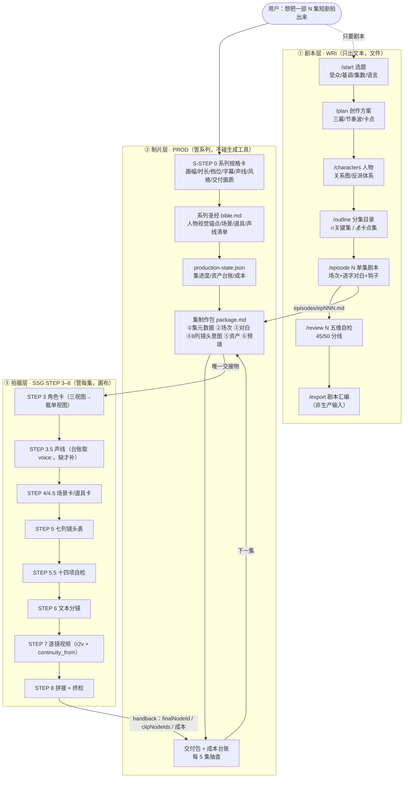
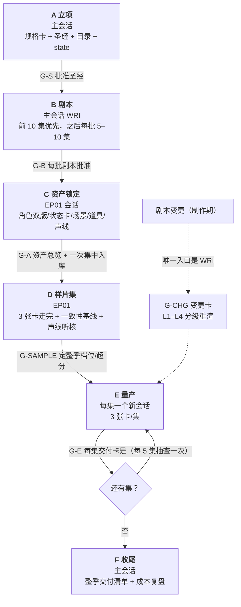
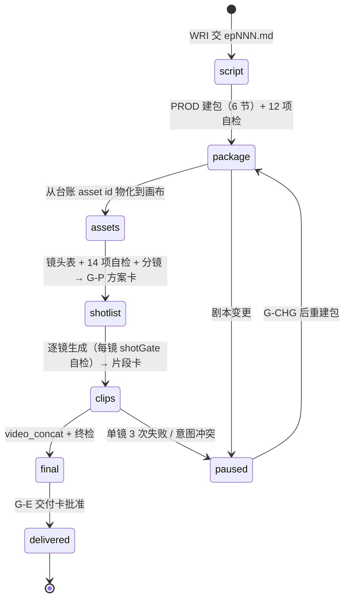
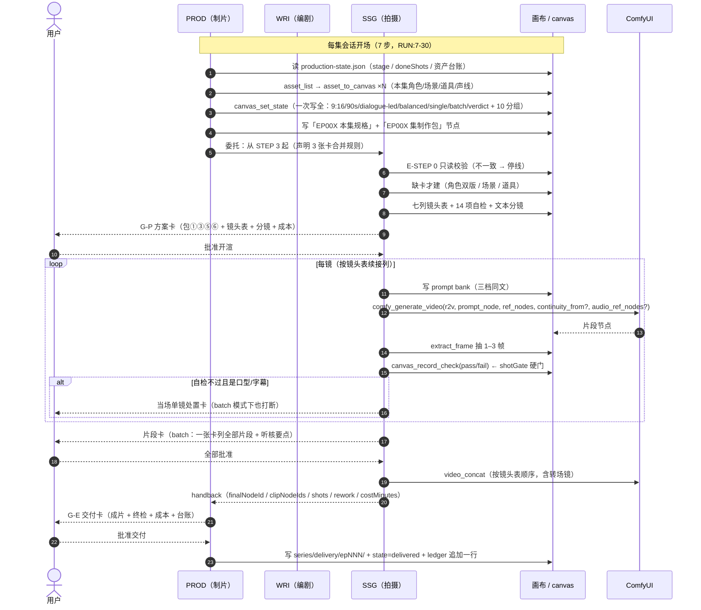
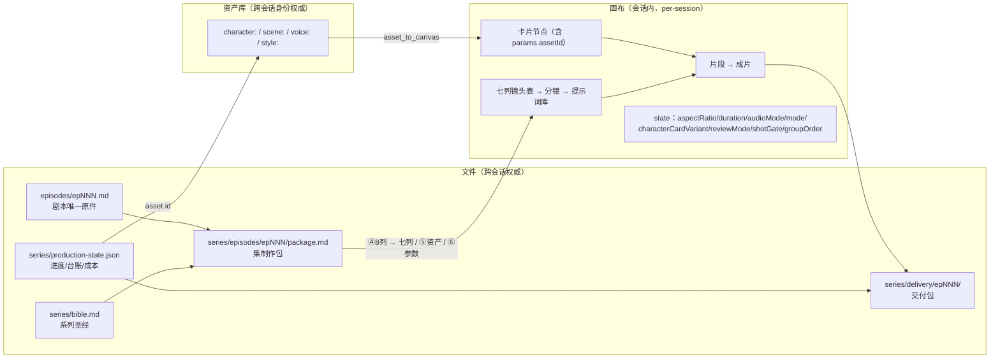
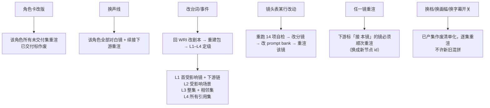

# 连续短剧三段流水说明（当前版本）

> 目的：把「三个 skill 怎么接力做出一部短剧」画成一张可讨论的图，再逐条评估它合不合理。
> 审计对象（当前工作树版本，与 `~/.dsh/skills/` 安装副本逐字一致，仅 manifest 不同）：
> `skills/short-drama-series-production/SKILL.md`（**PROD**，510 行）、
> `skills/short-drama-series-writer/SKILL.md`（**WRI**，600 行）、
> `skills/story-short-generator/SKILL.md`（**SSG**，917 行），
> 以及 `PROD/references/{production-runbook,episode-package}.md`（**RUN** / **PACK**）。
> 正文里的 `PROD:` / `SSG:` / `PACK:` / `RUN:` 行号是**审计时（2026-10-28）**的工作树行号，未随 §9 的落地改动重算（§9 各条的证据列同理，看内容、不认行号）。
> 代码门按当前工作树：`lib/index.js:3818-3933`（短剧制片门）、`:3934-4219`（镜头表一致性门）、`:4220-` 起（逐镜自检门）。

---

## 0. 一句话

**WRI 写文本 → PROD 定「拍什么/花多少/谁批准」→ SSG 定「怎么拍/每镜怎么生成」**；三者之间**只传一个文件**（集制作包 `package.md`），跨集只靠**两样东西**（`series/` 目录 + 资产库）；每集 **3 张人工卡**、**每镜 2 道代码门**。

```
WRI: episodes/epNNN.md（剧本，唯一原件）
  └─ PROD: series/episodes/epNNN/package.md（6 节 + 8 列镜头意图 + 资产清单 + 预填参数）
       └─ SSG STEP 3–8（画布：卡片 → 七列镜头表 → 分镜 → 提示词库 → 片段 → 成片）
            └─ PROD: 交付包 + 台账 + 下一集
```

---

## 1. 三个 skill 的分工（谁做什么 / 明确不做什么）

| | 触发 | 产物 | **明确不做** | 一句话 |
|---|---|---|---|---|
| **WRI** | 要剧本：题材/人物/分集目录/单集剧本 | 文件：`creative-plan.md`、`characters.md`、`episode-directory.md`、`episodes/epNNN.md` | 不写镜头表/分镜/角色卡/镜数 | 「怎么写台词」 |
| **PROD** | 要整部成片：量产、第 N 集、样片集、继续拍 | 系列圣经、分集目录、`production-state.json`、集制作包、交付包、台账 | **不调任何图片/视频生成工具**、不写剧本、不定义拍摄规则 | 「拍什么、用哪些 asset id、花多少、谁批准」 |
| **SSG** | 要做出一条片（单片）或**拍某一集**（委托） | 画布：卡片、镜头表、分镜、提示词库、片段、成片 | 不写系列台账/资产库/交付包 | 「怎么拍、每镜怎么生成、AI 自检过不过」 |

**两条只有一处是非重叠的**：`canvas_set_state`（画布项目设置）**只有 PROD 写**（每集会话开场一次），SSG 只读/校验/缺值停线（`PROD:332-341`、`SSG/references/series-delegated-mode.md:37-68`）；`package.md` 只有 PROD 写，SSG 只读。

---

## 2. 全景流程图



> 实线 = 数据流；虚线 = 可选入口。**单向闭环**：PROD 建包 → SSG 拍摄 → SSG 交回 handback → PROD 记台账 → 下一集。

---

## 3. 生命周期：阶段 A–F 与闸门



**顺序硬约束**（`PROD:164`）：`A → B（至少前 1 集）→ C → D → E`；**C 之前不许开渲片段**（否则身份锚点变化 → 全部返工）。

### 3.1 单集状态机（`production-state.json` 的 `stage`）



---

## 4. 单集生产时序（最值得讨论的一段）



**三道门的三层结构**（不要混）：

| 层 | 是什么 | 谁执行 | 每集次数 |
|---|---|---|---|
| **人工门** | `ask_user_question` 选项卡 | 用户 | **3**（方案 / 片段 / 交付）+ 异常门（G-ref、3 次失败、口型字幕、意图冲突） |
| **代码硬门** | 插件 pre-execute 拦截 | `lib/index.js` | 每镜 2 次：**镜头表一致性门**（台词/字幕逐字、length↔时长、声线参考、宽高、fast 不得用三视图）+ **shotGate**（未 pass 不许下一镜） |
| **AI 自检门** | 抽帧读图 + 14 项表检查 | 模型自己 | 每镜 1 轮（6 项：plan/character/lipsync/subtitle/contamination/audio/style） |

> `shotGate=verdict`（默认）会拦；`reviewMode=batch` 只减少**人工**确认次数，**不减 AI 自检次数**（`SSG:687`）。

---

## 5. 交接物与真相源



**真相源优先级**（我建议显式写死，目前散在各处）：
`series/bible.md §1` ＞ `production-state.series` ＞ `package.md ⑥` ＞ 画布 `state` ＞「本集规格卡」（只读展示）。
冲突处置：**停线**，不许 AI 静默取一个（`series-delegated-mode.md:59-66` 已对 state 这么规定，但没有覆盖圣经↔包）。

---

## 6. 返工传播（这套流程最贵的部分）



**铁律**：续接链上任何一环重渲 ⇒ 下游顺次重渲（`SSG:891`）；`balanced → quality` 会打断链；**逐镜超分 / 逐镜补帧不打断链**（后处理，不改采样 latent）。

---

## 7. 成本与节奏（PROD 的预算口径）

| 项 | 单值 | 每集（18 镜 / 90s / balanced / 9:16） |
|---|---|---|
| 片段 `balanced` 768×1344 | ≈166 s/镜 | ≈50 min |
| 转场镜（≤1，i2v） | ≈177 s | ≈3 min |
| 重渲（经验系数 1.3–1.5） | — | +15–25 min |
| 逐镜超分 1080×1920（可选） | ≈262 s/镜 | +78 min |
| 逐镜补帧 48fps（可选） | ≈10.5 s/镜 | +3 min |
| 抽帧自检 / 拼接 / 导出 | 秒–分钟级 | ≈2 min |
| **合计** | | **≈70 min 原生 / ≈150 min 超分** |

整季 80 集 ≈ **93 GPU 小时**（原生，满负荷 ≈4 天）；一晚 4–6 集是现实节奏（`PROD:360-365`）。**成本数字与 SSG 的实测表自洽**（166.3 s / 396.6 s / 2.38×，与 PROD 的「quality ≈2.4×」一致）。

---

## 8. 设计上我认为对的地方

1. **三层职责用「负向边界」写死**（PROD 不碰生成工具、SSG 不写台账、WRI 不写镜数）——这是这套流程最硬的部分。三者的失职点都能被下游立刻发现，而不是悄悄漂移。
2. **单一交接物**：`package.md` + 机读块（`contract: episode-package/v1`）+ JSON Schema + 校验脚本。契约可机械校验，而不是靠 prompt 自律。
3. **人工门砍到 3 张/集，且砍得克制**：合并的是**人工确认**（门 1/门 2/分镜模式/分镜批准/渲染参数 → 一张方案卡），**没合并自检**（14 项照跑、门 3 逐镜照跑），且口型/字幕这类人比 AI 更省的判断**保留当场打断**。
4. **资产是「一次性 + id 引用」**：阶段 C 一次锁定、入库、全季 `asset_to_canvas` 复用；角色卡两版**按构造成立**（三视图裁正面格，不重绘），把「两个版本像不像」从抽样运气变成确定性问题。
5. **续接用 latent 链而不是首帧**：`continuity_from` 让接缝从「看起来接上了」变成「服务端逐帧钉住」；同时把「哪镜接哪镜」提前写进镜头表第 3 列并在 STEP 5.5 做闭合性校验（第 9/10 项）——**规划期拦，不留到渲染期**。
6. **成本与规模闸**：档位闸（整季同档）、样片闸（EP01 不过不进 EP2）、规模闸（≥20 集先出预算表）、每 5 集抽查。量产最怕的「闷头跑完 80 集才发现资产错了」被三处拦住。

---

## 9. 我认为仍然薄弱的点（按严重度排序，逐条可讨论）

> **2026-10-28 已落地**：Q1 / Q2 / Q4 / Q5 / Q7 / Q8 / Q9 / Q10 已改入 skill 与契约（改动清单见 §11）；**Q3 已定**（三档成本实测：删除，改用注册表 + §9.1 实测表 + EP01 实际耗时）。下表是审计时的原始判断，保留作依据。

| # | 问题 | 严重度 | 证据 | 建议 |
|---|---|---|---|---|
| **Q1** | **阶段 C 到底谁执行生成？** PROD 的 RACI 写「卡片归 SSG、PROD 不调用任何生成工具」，但 §6 的三小节用祈使句直接要求「先出 three 再 crop」「场景卡单视图」——**没写执行者**。只有 RUN §2.1 对「每集缺卡」写了「交 story 生成」，**阶段 C 的首次建卡没有对应条款** | **S1** | `PROD:51-63` vs `PROD:281-298`；`RUN:47-56` | §6 开头加一行「本阶段 = PROD 主持 + 委托 SSG 生成 + PROD 入库/记账」，与 RUN §2.1 同构 |
| **Q2** | **「剧本依据: B0x」在剧集模式下无编号可回指**。第 12 项要求「每个 beat 至少被 1 镜覆盖，B01…Bxx 必须出现在某镜首行」，但包的 `beat` 字段是**节拍类型**（钩子/爽点-打脸/…），没有 id；PROD 又要求「逐镜回填 `剧本依据: B0x`」 | S2 | `SSG:465-471`（第 12 项）、`PACK:56-68`、`PROD:350` | 包 ④ 给每镜加 `beatId: B01…`（或规定「按镜序即 beat 序」），否则第 12 项 ① 只能判「非空」，覆盖性不可核 |
| **Q3**（已定：删除） | **三档成本实测 vs 续接链冲突**。G-SAMPLE 要求「抽 3 镜同 seed 分别跑 fast/balanced/quality」，但改档会改变**首遍采样尺寸**⇒ 该镜若在链内，`continuity_from` 会显式报错 / 断链 | S2 | `PROD:318`、`SSG:638`、`SSG:677` | **结论：删除**（Q3 定案）——改用注册表 + §9.1 实测表 + EP01 实际耗时；仅条件触发时测 1 镜副本 |
| **Q4** | **3 张卡的合并只在 PROD 侧声明**。SSG 的 STEP 5.5 结尾、STEP 6 开头仍写着「出选项卡」，只有 STEP 8 显式写了「委托模式不弹交付卡」。AI 读到 SSG 正文时很可能照弹 | S2 | `SSG:475`、`SSG:481-486`、`SSG:583-585` vs `PROD:351`、`series-delegated-mode.md:72` | 在 SSG 的 STEP 5.5 / 6 各加一行「委托模式下不弹，并入方案卡」 |
| **Q5** | **跨集连戏无机制**。「跨集不续接、集间硬切」是安全默认，但同场景连续剧情的集尾→集首硬切观感会断。i2v 双端锚定其实只需要两张静帧，架构上可行，但**画布节点是 per-session、`ref_nodes` 只吃画布节点/资产 id**，上集末帧没有合法的跨会话载体 | S2（产品级） | `PROD:431`、`SSG:641-645`、插件契约「只有图片类资产能作 ref_nodes」 | 二选一：① 接受硬切（写进交付说明）；② 给插件加「帧资产」类型或允许 `first_frame_node` 走工作区路径 |
| **Q6** | **BGM 有素材能力、没有混音能力**。`bgmMode` 只有 `none` / `in-model`（逐镜自带、硬切可能换曲），`separate`（Music 3 独立音轨 + 后期混音）标「下一期」。插件其实有 `comfy_generate_music` 和 ffmpeg（拼接已在用），缺的只是「贴轨 + duck」这一步 | S2 | `PROD:444`、`SSG:792` | 加一个「BGM 贴轨」能力（ffmpeg amix，按镜头表逐镜入出点），或至少在交付卡里给「生成 BGM 素材」选项，别当纯后期 |
| **Q7** | **S-STEP 0 一张卡塞 14 项**（四组选项）。规格卡设计是对的，但首次使用要在任何产物出现前答完画幅/时长/音频/档位×2/字幕/BGM/卡版本/审查/自检/声线/交付画质/风格/语言 | S2（体验） | `PROD:102-132` | 给 2–3 个**套餐**（A 原生 balanced / B 超分 1080 / C quality 精修），选中后只在「微调」里改单项 |
| **Q8** | **脚本路径是仓库相对路径**。「生成后跑 `node scripts/smoke-skill-contract.mjs`」——用户项目工作区里没有 `scripts/`（该脚本按 `import.meta.url` 解析仓库根），在真实项目里必失败或被静默跳过 | S3 | `PROD:403`、`PACK:41`、`scripts/smoke-skill-contract.mjs:17-19` | 改成「用 skill 目录下的校验器」或把 `validate-episode-package.mjs` 随 skill 安装 |
| **Q9** | **残留过期描述**：`PROD:71` 说「角色卡仍 **2:3** 竖版」，与 §6.1 的「three 16:9 / single 正面格 ≈0.59」矛盾（旧规则残留） | S3 | `PROD:71` vs `PROD:281`、`SSG:282-286` | 一行删改 |
| **Q10** | **声线跨集一致性「未实测」**，而它恰好是换声线代价最高的一项（该角色全部对白镜 + 下游重渲）。样片集只要求「每个说话角色抽 1 句」 | **S1**（质量） | `PROD:320`、`PROD:434`、`SSG:699` | 样片集听核扩成矩阵：每角色 × 3 种镜（近景对白 / 全景对白 / 续接镜）各 1 句，成本 ≈ +5 min，换掉全季最大不确定性 |

---

## 10. 需要一起决策的四件事

1. **量产的人工密度还能再降吗？** 现在 3 张/集 × 80 集 = 240 次触达，加每 5 集抽查约 16 次。可以再砍的是「交付卡」：batch 卡已列全部片段与听核项，两卡选项 80% 重叠。→ 合并成 2 张/集（方案 / 片段+交付），还是保留交付卡的「签字」语义？
2. **集间连戏要不要做？**（Q5）这决定「连续短剧」是 80 条独立短片，还是一条真正的连续剧。做的话要动插件契约（帧资产），成本 ≈ 1 个转场镜/集 + 插件改动。
3. **BGM 走「引擎自带」还是「独立音轨」？**（Q6）前者零成本但硬切换曲、不可 duck；后者要补 ffmpeg 贴轨能力（估 0.5 天），换来可复用主题曲与情绪曲线。
4. **规格卡要不要改成套餐 + 微调？**（Q7）影响每个用户第一次打开这部车的摩擦，不影响流程正确性。

---

## 附：证据索引

| 文件 | 关键行 |
|---|---|
| `PROD/SKILL.md` | 分工 29-49；RACI 51-63；参数表 67-84（Q9 在 71）；S-STEP 0 102-132；阶段总览 155-162；目录/状态 176-231；A 244-259；B 263-269；C 273-310；D 314-326；E 330-365（8.1 在 332-341、覆盖表 343-352）；成本 371-397；集制作包 401-423；跨集纪律 427-436；交付 439-452；异常 456-481 |
| `PROD/references/production-runbook.md` | 每集开场 7-30；单集序列 34-93；断点续跑 97-109；台账 113-124；每 5 集抽查 127-135 |
| `PROD/references/episode-package.md` | 六节 9-24；机读块 26-41；8 列 45-68；预算 72-85；示例 89-178；节拍映射 182-194；⑥ 197-215；12 项自检 219-234 |
| `WRI/SKILL.md` | 目录 14-35；命令 72-568；单集格式 260-305；质量要求 338-349；导出 420-497；创作原则 570-585 |
| `SSG/SKILL.md` | 门 0 196-228；STEP 3 269-329；3.5 331-334；STEP 4 336-352；STEP 5 381-445；STEP 5.5 447-477；STEP 6 479-585；STEP 7 587-705；门 3 683-726；转场 737-774；STEP 8 780-903；重生成纪律 881-903 |
| `SSG/references/series-delegated-mode.md` | 门 0 探测 9-35；E-STEP 0 37-68；硬边界 70-78 |
| 代码门 | `lib/index.js:3814-4090`（镜头表一致性门）、同文件 shotGate 相关段 |

---

## 11. 修订记录（2026-10-28，选项已确认）

| # | 决策 | 改动落点 |
|---|---|---|
| **Q2** | **A**：包 ④ 加 `beatId` + `beats[]` 清单 | `schemas/episode-package.schema.json`（新增 `beats[]`、`shots[].beatId`）；`scripts/validate-episode-package.mjs`（beat 覆盖机械校验：缺 beatId / 编号越界 / beat 无人拍 / 重复 = error）；`scripts/fixtures/episode-package.example.json`；`PACK` §2 第 8 列 + 新增 §2.1 + §7 第 4 项；`PROD` §8.2、§10；`SSG` STEP 5 / 5.5 第 12 项 |
| **Q1** | **A**：PROD 主持 + 委托 SSG 执行 | `PROD` §6 开头分工块（含「跳过门 0 / E-STEP 0」防死循环条款）；`RUN` §2.1 |
| **Q5** | **A**：本期硬切，写清说明 | `PROD` §11.3（说明架构原因 + 帧资产列为下一期）、§12 交付包「集间关系」；`RUN` §2.4 |
| **Q4** | 委托模式不弹卡 | `SSG` STEP 5.5 末尾、STEP 6 开头各加「剧集委托模式例外」 |
| **Q7** | 规格卡改套餐 + 微调 | `PROD` §1.1（A 原生 / B 1080 / C 高质量 + 四组微调项） |
| **Q8** | 校验脚本路径 | `PROD` §10、`PACK` §1.1（明确「在插件仓库/安装目录跑」+ 手工核对兜底） |
| **Q9** | 删 2:3 残留 | `PROD` §1 参数表「画幅」行 |
| **Q10** | 声线听核矩阵 | `PROD` §7 第 3 项（每角色 × 近景对白 / 全景对白 / 续接镜 各 1 句） |
| **Q3** | **D：删除** | 从 EP01 七项里删掉「三档成本实测」；改为「默认不做，仅用户要比某档 / 耗时偏差>30% / 换实现换卡时测 1 镜副本」；G-SAMPLE 卡去掉三档项，并注明 quality 锐度实测不及 balanced |

**验证**：`node scripts/smoke-skill-contract.mjs` 61/61 通过；`npm run validate:bridge` 两份历史包仍 0 error（旧包无 `beats[]` → 只给 warning，向后兼容）；beat 校验用 6 个正反例逐一验证（缺 beatId / 编号越界 / beat 无人拍 / 编号重复）。
**生效前提**：`~/.dsh/skills/` 是插件安装副本、本次不可写 —— **重启 DSH 后插件按内容哈希自动刷新**，之后新会话才会读到改后文本。
